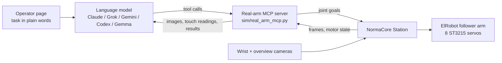

# Talk to the arm: a language model operating a real robot arm through tools

Hacklab Robotics Hackathon, 21-22 November 2026.

You type a task in plain words ("sort the 3D parts into the blue box, packages into the orange box, paper into
the yellow box"). A language model then operates a real NormaCore ElRobot arm until the task is done: it looks
through the cameras, decides, moves, grips, checks its own work and reports `DONE` or `BLOCKED` with the reason.

There is no trained policy and no task-specific code. The model gets a small set of well-behaved tools and a
one-page instruction sheet. Everything else it works out from the camera images, every run.

## What is in here



| Piece | File | What it does |
|---|---|---|
| Arm tool server | `sim/real_arm_mcp.py` | 22 tools over MCP: look, move, pick, place, drop, wipe, stir, touch sense. Does the kinematics, the motion safety and the sensing so the model does not have to. |
| Operator instructions | `sim/OPERATOR_TEMPLATE.md` → `sim/OPERATOR_REAL.md` | The one page the model reads. Rendered from the robot profile, so numbers in the text always match the code. |
| Robot profile | `sim/robots/elrobot.json`, `so101.json` | Every robot-specific number (motors, cameras, speeds, grip, touch thresholds) in one file. A second profile for an SO-101 arm is included, tested offline only. |
| Operator page | `sim/operator_ui.py` | Web page: type a task, Enhance it, Start / Resume / Stop, live cameras, live tool-call log, arm buttons (open gripper, park, relax, hold). |
| Runners | `sim/run_agent_real.sh`, `sim/run_agent_openai.py` | Start a run with Claude, or with any OpenAI-compatible endpoint (Gemini, Gemma). |
| Simulator twin | `sim/sim_arm_mcp.py`, `sim/build_scene.py` | The same tool surface on a MuJoCo model, used to develop tools before trying them on hardware. |
| Joint-level server | `arm_mcp/`, `robot_mcp/` | The first, lower-level MCP server (joint moves, torque, camera frames). |
| Camera pose | `camera_pose/`, `calibration/` | Wrist-camera geometry and calibration work. |
| Lab notebook | `LOG.md`, `sim/REAL_ARM.md` | What we tried, what worked, what did not, with measurements. |

## The ideas that made it work

**1. Nothing about the table is given.** Boxes and items move between runs, so positions are never written into
a task. A run starts with `survey()` (three wrist-camera views plus the overview). Every image carries a pixel
grid, and `pixel_to_table(u, v)` turns a pixel into a point on the table using the arm's own kinematics and the
wrist camera's mount. The model picks pixels; the server does the geometry.

**2. One tool call per intention.** `pick_at(x, y)` is the whole pick: open, hover, descend, close until the jaws
stall, lift, verify. `drop_at`, `place_at`, `wipe`, `stir`, `grab_tip` are the same kind of thing. Fewer, larger
steps mean fewer model turns, which is where the time goes.

**3. The box first, with an empty gripper.** A held object hides the box from the wrist camera. So the model
fixes each drop position before picking anything: `center_over(u, v)` slides the gripper until a green DROP line
drawn in the image ends inside the box opening.

**4. Touch, from the motors.** The arm has no force sensor. We read position lag and load from the servos:

- every grip returns a `touch:` line (jaw gap in mm = the object's width, motor load, and a verdict);
- `grip_force` limits the squeeze, so hard smooth things are not shot out of the jaws;
- a held object is verified by asking the jaws to close a little more: free jaws follow, held jaws do not;
- descents near the table go in small steps and stop when the fingertips touch, so picks no longer push into
  the table and slide;
- thin sheets (one layer of tissue is about 0.2 mm of jaw travel) are judged by whether the jaws stay as far
  apart after a lift as when they gripped.

Every threshold here was measured on the arm, not guessed. The first version of table sensing was shipped
untested and made picks stop in mid-air; the notebook has that story.

**5. Servos that only do P control.** The ST3215s sag under load and overshoot when rushed. Moves are driven in
small closed-loop steps with a speed cap per step, and a move that stops tracking is aborted and reported
instead of forced.

**6. No hard-coded numbers in the tools.** All of the above lives in the robot profile. A golden-reference
check (48 kinematics cases and 20 tool calls on a simulated motor bus) confirmed the refactor changed nothing.

## What it did on the real arm

| Task | Operator | Result |
|---|---|---|
| Sort 3 items into 2 boxes (Sat) | Claude Sonnet, low effort | 3 of 3 in 189 s |
| Same | Claude Opus | 3 of 3 in 104 s |
| Sort 6 items into 3 trays by kind (Sun) | Claude Sonnet, low effort | 5 of 6 in 296 s, the sixth in a 70 s follow-up run (a shoulder-motor overload stopped the first run at the edge of reach) |
| Pull a tissue out of its pack, wipe a spill, bin the tissue (Sat) | Claude | worked once the tip-grab and firm pull were added |
| Same (Sun) | Claude Opus, Sonnet, Gemini 3.8 Flash | BLOCKED each time: the pack lifts with the sheet or the sheet slips. A physical problem, not a model one. |
| Put a small gear into a ring gear | tool calls by hand, new `place_at` | seated upright once; stacking the second gear was not reached |
| One loose tissue into a box | Grok 4.7 low-fast (through Cursor's agent) | DONE in 242 s |
| One small item into a box | Codex gpt-6.2-astra, fast, low effort | drove the arm correctly, BLOCKED twice: nothing small was within reach |
| Sorting | Gemma (small, self-hosted) | not usable: guessed pixel positions and reported success that had not happened |

The same tool layer was driven by five model families. Claude was the most reliable in our runs, but the tools
and instructions were tuned against Claude over two days and the other models got one or two runs each, on
different tasks. This is not a benchmark.

Logs of real runs are in `sim/real_runs/`. Each run writes every tool call with arguments, result and duration
to `sim/real_sessions/actions.jsonl`, plus the model's full transcript.

## What does not work yet

- **Reach.** Beyond about 30 cm from the base the gripper leans 30-70°, positions from the wrist camera are off
  by several centimetres, and the shoulder motor reports overload. Keep things within about 25 cm.
- **Bottle caps and other small hard round things** are still not picked reliably.
- **Touch while carrying a part** is weak: `place_at` needs two signals to agree, so a light touch can go unfelt
  and the part is then released at the lowest allowed height.
- **The overview camera is not calibrated.** It is used for context only.
- **`pick_thin` and the new thin-sheet hold check** have held a real sheet through a lift once. That is all the
  hardware evidence there is.

## Run it

Needs NormaCore Station running with the arm and two USB cameras (TCP API on `localhost:8888`), `uv`, and the
`claude` CLI logged in.

```bash
# cameras relay (for the page) and the operator page
python3 scripts/cam_stream.py --data-dir <station data dir> &
python3 sim/operator_ui.py            # http://127.0.0.1:8894

# or one run from the shell
bash sim/run_agent_real.sh --model sonnet --effort low \
  -p "Task for this run: put the loose items into the boxes: paper into the yellow box, the rest into the blue box."

# any OpenAI-compatible endpoint instead of Claude (Gemini, Gemma, ...)
MODEL_BASE_URL=... MODEL_NAME=... MODEL_API_KEY=... bash sim/run_agent_model.sh -p "..."
```

Camera IDs change when the cameras are re-plugged: set `ROBOT_WRIST_CAM` and `ROBOT_OVERVIEW_CAM` to the new
ID prefixes, or edit the profile. For another arm, set `ROBOT_PROFILE=so101` (see `sim/robots/README.md`).

Safety: a person must watch the arm and be ready to stop it. Stop leaves the servos holding their last goal.
Relax switches torque off and a raised arm drops. Other scripts that write a speed cap to the motors
(`scripts/arm.py hold`) are fine: the gripper tool clears it on the jaw motor on every call.

## How the two days went

1. **Joint-level MCP server** on the real arm, shared with the team over the LAN, with camera frames.
2. **Wrist-camera geometry**, so a pixel can be turned into a table position.
3. **Simulator twin** with task-level tools, then the same tools ported to the real arm.
4. **First autonomous sort** on hardware; then a pass on speed (one-call picks, fewer turns, low effort).
5. **Adaptability**: coordinates removed from tasks; survey, DROP line and box-first procedure.
6. **Operator page** and a task enhancer that rewrites a casual instruction using the camera images.
7. **Touch sense**, table sensing, stirring, tip-grab and wiping.
8. **Robot profiles**: every constant out of the code, second arm profile, golden-reference check.
9. **Sunday**: recorded runs, `pick_thin`, `place_at`, the gripper speed-cap fix, and other model families.
