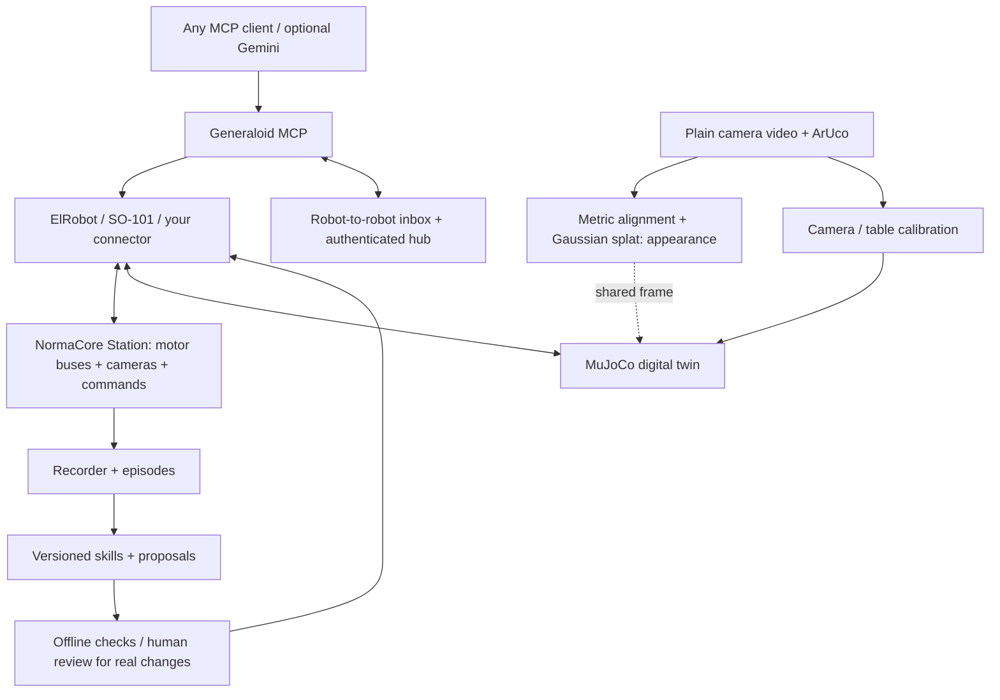
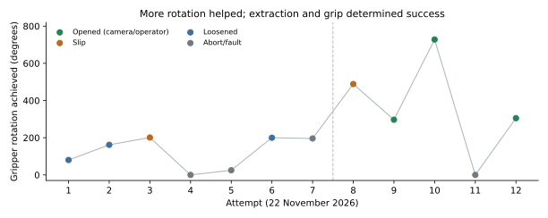

# Generaloid

> 🥇 **1st place — [AI × Robotics Hackathon II](https://hacklabrobotics.com/articles/hacklab-edition-2-november-2026)**, HackLab × BRISA, CIC Berlin, 21–22 November 2026.

Built by:  Vibbodh Somani, Evgenii Chubar, Zvonko Vugreshek, Serhat Alp Acar

<video src="https://github.com/iambodha/Hacklab-Robotics-Hackathon-2/releases/download/v1.0/Generaloids_LinkedIn_Final.mp4" poster="https://raw.githubusercontent.com/iambodha/Hacklab-Robotics-Hackathon-2/main/docs/assets/demo_poster.jpg" controls muted playsinline width="100%"></video>

*75 s demo — sorting, wiping a spill, and the bottle-cap skill the model taught itself. If the player does not appear, [watch it on the release page](https://github.com/iambodha/Hacklab-Robotics-Hackathon-2/releases/tag/v1.0).*

You type a task in plain words ("sort the 3D parts into the blue box, packages into the orange box, paper into the yellow box"). A language model then operates a real **NormaCore ElRobot** arm — a fully 3D-printed, ~$220, 7+1 DoF arm — until the task is done: it looks through the cameras, decides, moves, grips, checks its own work and reports `DONE` or `BLOCKED` with the reason.

On top of the same tool surface, the model then **taught itself a skill**: unscrewing a bottle cap. Over 14 recorded real-arm attempts it wrote a hypothesis, chose skill parameters, ran the motion, judged the result from motor telemetry and camera images, and wrote down what it learned. The model never touched the arm directly — it proposed parameters; the skill, safety limits and record-keeping were hard in code. Learning happened *in context*, from its own attempt history.

Generaloid is a hardware-agnostic, model-agnostic robot MCP platform built around **NormaCore Station**.  
Station owns the motor buses, cameras and hardware commands; robots plug in as connectors.  
Any compatible MCP client can use the tools, with optional Gemini advice and human review.  
Plain cameras, ArUco markers and Gaussian splats connect a measured workspace to a MuJoCo twin.  
Episodes and versioned skill settings make improvement inspectable: the real ElRobot opened a bottle cap.



## What works, and what the evidence means

| Result | Evidence and qualification |
| --- | --- |
| Real bottle opening | [Twelve recorded attempts](docs/learning/README.md): round 1 (1–7) loosened; attempts 9 and 10 opened; attempt 11 aborted; demo attempt 12 opened after 11 × 32° strokes, 305.1° measured gripper rotation and a 65 mm commanded lift. These are iterative operator-guided trials on one setup. |
| Learned settings shared by real/twin tools | [Bottle profile and rollback](docs/learning/PROFILES.md): 0.5 torque fraction, −6.5 mm depth, slow 32° strokes, 60 mm extraction, 12-stroke ceiling. The physical MuJoCo contact/extraction gap remains [unresolved](docs/learning/VALIDATION.md). |
| Two robot twins over MCP | [Connector checks](docs/generaloid/VALIDATION.md): ElRobot lifted a cube to 110 mm, SO-101 to 115.6 mm. Physics-only checks used labeled diagnostic camera images. SO-101 real calibration is unverified. |
| Plain-camera splat pipeline | [Synthetic reconstruction](sim/splat/README.md): 90/90 frames registered; 0.46 mm mean marker alignment residual; 4.6 mm mean camera-centre error. This is a synthetic smoke test, not measured accuracy on an arbitrary real table. |
| Inter-robot comms — simulation only | [Distinct ElRobot + SO-101 twin processes](docs/comms/evidence/README.md) negotiated help and exercised a local gripper move/refusal. No physical bottle hold or two-arm cooperation was verified. |
| Kitting — simulation only | [Held-out results](docs/kitting/RESULTS.md): 9/36 → 13/36 placements; no complete randomized kit. Selected settings completed 2/2 identical nominal kits (12/12 parts). CPU projections omit occlusion/shadows. |



Rotation above measures the gripper, which can slip on the cap. A short lift gave false positives; visible separation and a longer guarded extraction matter. See [known issues](docs/KNOWN_ISSUES.md) before interpreting a successful tool response as task success.

## The agentic part: a skill the model taught itself

The same MCP surface exposes a small learning protocol (`episode_history`, `episode_begin`, `episode_end`, `propose_skill_change`) next to the motion and perception tools. For each attempt the model:

1. **Reads the compact history of its own previous attempts** — parameters, measurements, outcomes and its own written lessons. *Memory lives in context, not weights.*
2. **Changes at most three skill parameters and writes a hypothesis.** `episode_begin` validates against bounds and refuses out-of-range values; it never silently clamps.
3. **Locates the cap itself** through the cameras, then runs `twist_cap` — a guarded composite skill that grasps with a torque limit, rotates in strokes while monitoring motor loads and gripper slip, and stops on a "cap free" signal (j7 load below 0.70× the break-away reference, twice in a row, after 280°).
4. **Judges the result** from telemetry plus a guarded 60 mm extraction lift, then writes `episode_end(outcome, lesson, next_change)`.

Over the attempts the cap went from barely turning (80°) to three openings — attempts 9, 10, and a clean 11-stroke demo take (12). Every failure produced a fix: slip → deeper grasp; overload → lower torque; timeout → `stop_on_free` + a time budget; bevel-riding → top-only approach + least-lean IK. The distilled knowledge is a versioned [learned profile](learning/profiles/bottle_cap.json): 0.5 grip torque, −6.5 mm grasp depth (**0.5 mm above the hard safety floor**), slow 32° strokes, 60 mm extraction — every value annotated with the attempts that produced it.

Safety limits are immutable and listed separately; proposed parameter changes for the real arm are **never auto-applied — a human approves each one**. The full attempt arc and honest caveats are in [docs/learning/](docs/learning/README.md) and [docs/STORY.md](docs/STORY.md).

## What the operator tools did on the real arm

The same tool layer was driven by five model families on unstructured tasks — nothing about the table is given, the model surveys the scene through the cameras every run:

| Task | Operator | Result |
|---|---|---|
| Sort 3 items into 2 boxes (Sat) | Claude Sonnet, low effort | 3 of 3 in 189 s |
| Same | Claude Opus | 3 of 3 in 104 s |
| Sort 6 items into 3 trays by kind (Sun) | Claude Sonnet, low effort | 5 of 6 in 296 s, the sixth in a 70 s follow-up run (a shoulder-motor overload stopped the first run at the edge of reach) |
| Pull a tissue out of its pack, wipe a spill, bin the tissue (Sat) | Claude | worked once the tip-grab and firm pull were added |
| Same (Sun) | Claude Opus, Sonnet, Gemini 3.8 Flash | BLOCKED each time: the pack lifts with the sheet or the sheet slips. A physical problem, not a model one. |
| Put a small gear into a ring gear | tool calls by hand, new `place_at` | seated upright once; stacking the second gear was not reached |
| One loose tissue into a box | Grok 4.7 low-fast (through Cursor's agent) | DONE in 242 s |
| One small item into a box | Codex gpt-6.2-astra, fast, low effort | drove the arm correctly, BLOCKED twice: nothing small was within reach |
| Sorting | Gemma (small, self-hosted) | not usable: guessed pixel positions and reported success that had not happened |

Claude was the most reliable in our runs, but the tools and instructions were tuned against Claude over two days and the other models got one or two runs each, on different tasks. This is not a benchmark. The design lessons behind the tool surface — one tool call per intention, box-first with an empty gripper, touch from the motors, no hard-coded numbers — are written up in [docs/TALK_TO_THE_ARM.md](docs/TALK_TO_THE_ARM.md).

## Quickstart: no robot, model account or API key

Install [uv](https://docs.astral.sh/uv/), open a source checkout in a terminal, and run:

```sh
bash quickstart.sh
```

This installs the `sim` extra, downloads a checksum-checked **separate NormaCore source archive** for its URDFs/meshes, and runs an ElRobot pick through MCP against MuJoCo. It prints JSON with `picked: true`. By default it is a **physics-only demo with diagnostic images**, so it also works without a desktop graphics connection. First run needs internet and disk space for dependencies and the ~70 MB upstream archive. It never starts Station or connects to a robot.

```sh
bash quickstart.sh --connector so101     # other robot, same MCP check
bash quickstart.sh --rendered            # real camera rendering; requires working OpenGL
bash quickstart.sh --serve               # ordinary twin MCP server on stdio for your MCP client
```

Use `MUJOCO_GL=cgl` on macOS; Linux rendering needs a working OSMesa/EGL/GLFW backend selected with `MUJOCO_GL`. Windows users can use WSL. Only the macOS sandbox's physics-only path was freshly validated in this release; see [setup, extras and testing](docs/release/QUICKSTART.md). Python 3.11–3.13 is declared; uv selects a compatible interpreter. This is source-checkout packaging; standalone wheels are not yet supported.

**Sites — in progress: r6.** The `home` setup records the earlier table; `office` is the new table. The site registry and office calibration/twin are being developed in parallel. Home calibration is evidence of the old setup, not calibration of the new table.

## Bring your robot; build your twin

Follow [writing a connector](docs/generaloid/WRITING_A_CONNECTOR.md): declare joints, gripper, cameras, frames, safety envelope, kinematics and mount lifecycle; keep real I/O behind Station. [SO-101](generaloid/connectors/so101/) is the worked example. One connector runs per process.

For your own table, follow the [twin guide](docs/twin/README.md), [camera/marker calibration](perception/README.md), [wrist geometry](camera_pose/HANDOFF.md) and [video → Gaussian splat](sim/splat/README.md). The splat supplies appearance in a metric frame; MuJoCo supplies physics and collision geometry. Large reconstructions stay outside git.

[Comms](docs/comms/README.md) exchanges requests, observations and progress through an authenticated hub. Incoming messages are untrusted data; the local agent chooses its own actions. [Security and limits](docs/comms/SECURITY.md) explain why cancellation messages are not hardware stops.

The [learning loop](docs/learning/PROFILES.md) records attempts → diagnoses → bounded proposals → offline checks → versioned settings. Real configuration changes require human approval; Gemini advice is optional. The [executor](RUN.md) owns asynchronous motion for its workflows, with [recorder](recorder/README.md) evidence and a [dashboard](docs/dashboard/README.md).

## Repo map

| Path | Role |
| --- | --- |
| `generaloid/` | MCP assembly, Station adapter, connectors, generic twin, comms |
| `sim/`, `sim/splat/` | ElRobot twin, real-arm MCP server, calibrated scenes, reconstruction |
| `perception/`, `calibration/`, `camera_pose/`, `sites/` | Geometry, calibration evidence and developing setup registry |
| `learning/`, `skills/`, `tasks/` | Episodes/config, reusable skills, bottle and kitting workflows |
| `executor/`, `models/` | Motion ownership and optional model advisors |
| `recorder/`, `dashboard/` | Capture, replay and learning inspection |
| `arm_mcp/`, `robot_mcp/` | Earlier compatible MCP entry points |
| [`docs/`](docs/README.md) | All guides, evidence, [story](docs/STORY.md), [operator-tools writeup](docs/TALK_TO_THE_ARM.md), [release journal](docs/release/JOURNAL.md) and [migration plan](docs/release/MIGRATION_PLAN.md) |

No source files were moved this round; real-arm entry points remain in their existing locations. Some historical commands and defaults are machine-local: [complete path inventory](docs/release/LOCAL_PATHS.md).

## Credits and license

Built at the **2nd Berlin Robotics & AI Hackathon, 21–22 November 2026** — 1st place. The team worked with Claude, Devin and Codex agents: overnight, 20+ agents ran in parallel git worktrees across seven build rounds (bring-up, recorder, perception, twin, executor, the bottle learning protocol, the self-tuning config layer, kitting-sim and the office-site port). NormaCore supplies Station, robot models and the hardware boundary; SO-101 work builds on TheRobotStudio's SO-ARM100 models/profile lineage. The reconstruction pipeline uses ffmpeg, COLMAP/GLOMAP and Brush; simulation uses MuJoCo. See the [history](docs/history/INTEGRATION.md) for workstreams and provenance.

Released under the [MIT License](LICENSE). Upstream dependencies/assets retain their own licenses.
