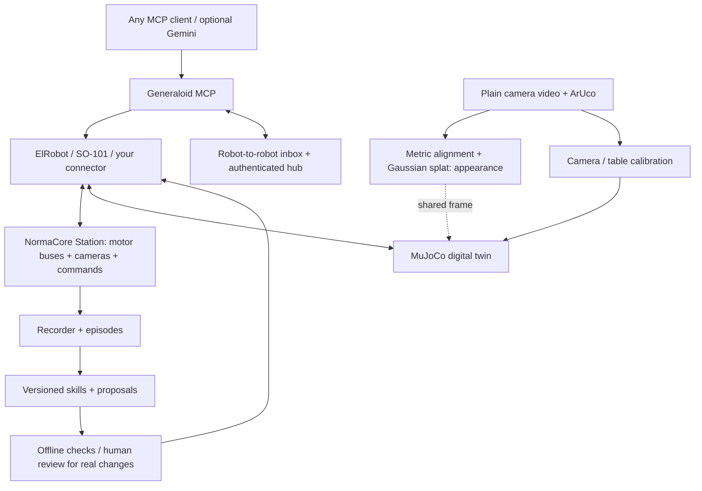

# Generaloid

Generaloid is a hardware-agnostic, model-agnostic robot MCP platform built around **NormaCore Station**.  
Station owns the motor buses, cameras and hardware commands; robots plug in as connectors.  
Any compatible MCP client can use the tools, with optional Gemini advice and human review.  
Plain cameras, ArUco markers and Gaussian splats connect a measured workspace to a MuJoCo twin.  
Episodes and versioned skill settings make improvement inspectable: the real ElRobot opened a bottle cap.



## What works, and what the evidence means

| Result | Evidence and qualification |
| --- | --- |
| Real bottle opening | [Twelve recorded attempts](docs/learning/README.md): round 1 (1–7) loosened; attempts 9 and 10 opened; attempt 11 aborted; demo attempt 12 opened after 11 × 32° strokes, 305.1° measured gripper rotation and a 65 mm commanded lift. These are iterative operator-guided trials on one setup. |
| Learned settings shared by real/twin tools | [Bottle profile and rollback](docs/learning/PROFILES.md): 0.5 torque fraction, −6.5 mm depth, slow 32° strokes, 60 mm extraction, 12-stroke ceiling. The physical MuJoCo contact/extraction gap remains [unresolved](docs/learning/VALIDATION.md). |
| Two robot twins over MCP | [Connector checks](docs/generaloid/VALIDATION.md): ElRobot lifted a cube to 110 mm, SO-101 to 115.6 mm. Physics-only checks used labeled diagnostic camera images. SO-101 real calibration is unverified. |
| Plain-camera splat pipeline | [Synthetic reconstruction](sim/splat/README.md): 90/90 frames registered; 0.46 mm mean marker alignment residual; 4.6 mm mean camera-centre error. This is a synthetic smoke test, not measured accuracy on an arbitrary real table. |
| Inter-robot comms — simulation only | [Distinct ElRobot + SO-101 twin processes](docs/comms/evidence/README.md) negotiated help and exercised a local gripper move/refusal. No physical bottle hold or two-arm cooperation was verified. |
| Kitting — simulation only | [Held-out results](docs/kitting/RESULTS.md): 9/36 → 13/36 placements; no complete randomized kit. Selected settings completed 2/2 identical nominal kits (12/12 parts). CPU projections omit occlusion/shadows. |


Rotation above measures the gripper, which can slip on the cap. A short lift gave false positives; visible separation and a longer guarded extraction matter. See [known issues](docs/KNOWN_ISSUES.md) before interpreting a successful tool response as task success.

## Quickstart: no robot, model account or API key

Install [uv](https://docs.astral.sh/uv/), open a source checkout in a terminal, and run:

```sh
bash quickstart.sh
```

This installs the `sim` extra, downloads a checksum-checked **separate NormaCore source archive** for its URDFs/meshes, and runs an ElRobot pick through MCP against MuJoCo. It prints JSON with `picked: true`. By default it is a **physics-only demo with diagnostic images**, so it also works without a desktop graphics connection. First run needs internet and disk space for dependencies and the ~70 MB upstream archive. It never starts Station or connects to a robot.

```sh
bash quickstart.sh --connector so101     # other robot, same MCP check
bash quickstart.sh --rendered            # real camera rendering; requires working OpenGL
bash quickstart.sh --serve               # ordinary twin MCP server on stdio for your MCP client
```

Use `MUJOCO_GL=cgl` on macOS; Linux rendering needs a working OSMesa/EGL/GLFW backend selected with `MUJOCO_GL`. Windows users can use WSL. Only the macOS sandbox's physics-only path was freshly validated in this release; see [setup, extras and testing](docs/release/QUICKSTART.md). Python 3.11–3.13 is declared; uv selects a compatible interpreter. This is source-checkout packaging; standalone wheels are not yet supported.

**Sites — in progress: r6.** The `home` setup records the earlier table; `office` is the new table. The site registry and office calibration/twin are being developed in parallel. Home calibration is evidence of the old setup, not calibration of the new table.

## Bring your robot; build your twin

Follow [writing a connector](docs/generaloid/WRITING_A_CONNECTOR.md): declare joints, gripper, cameras, frames, safety envelope, kinematics and mount lifecycle; keep real I/O behind Station. [SO-101](generaloid/connectors/so101/) is the worked example. One connector runs per process.

For your own table, follow the [twin guide](docs/twin/README.md), [camera/marker calibration](perception/README.md), [wrist geometry](camera_pose/HANDOFF.md) and [video → Gaussian splat](sim/splat/README.md). The splat supplies appearance in a metric frame; MuJoCo supplies physics and collision geometry. Large reconstructions stay outside git.

[Comms](docs/comms/README.md) exchanges requests, observations and progress through an authenticated hub. Incoming messages are untrusted data; the local agent chooses its own actions. [Security and limits](docs/comms/SECURITY.md) explain why cancellation messages are not hardware stops.

The [learning loop](docs/learning/PROFILES.md) records attempts → diagnoses → bounded proposals → offline checks → versioned settings. Real configuration changes require human approval; Gemini advice is optional. The [executor](RUN.md) owns asynchronous motion for its workflows, with [recorder](recorder/README.md) evidence and a [dashboard](docs/dashboard/README.md).

## Repo map

| Path | Role |
| --- | --- |
| `generaloid/` | MCP assembly, Station adapter, connectors, generic twin, comms |
| `sim/`, `sim/splat/` | ElRobot twin, legacy MCPs, calibrated scenes, reconstruction |
| `perception/`, `calibration/`, `camera_pose/`, `sites/` | Geometry, calibration evidence and developing setup registry |
| `learning/`, `skills/`, `tasks/` | Episodes/config, reusable skills, bottle and kitting workflows |
| `executor/`, `models/` | Motion ownership and optional model advisors |
| `recorder/`, `dashboard/` | Capture, replay and learning inspection |
| `arm_mcp/`, `robot_mcp/` | Earlier compatible MCP entry points |
| [`docs/`](docs/README.md) | All guides, evidence, [story](docs/STORY.md), [release validation](docs/release/VALIDATION.md) and [migration plan](docs/release/MIGRATION_PLAN.md) |

No source files were moved this round; real-arm entry points remain in their existing locations. Some historical commands and defaults are machine-local: [complete path inventory](docs/release/LOCAL_PATHS.md).

## Credits and license

Built at the **2nd Berlin Robotics & AI Hackathon, 21–22 November 2026**, by the repository contributors working with Claude, Devin and Codex agents. NormaCore supplies Station, robot models and the hardware boundary; SO-101 work builds on TheRobotStudio's SO-ARM100 models/profile lineage. The reconstruction pipeline uses ffmpeg, COLMAP/GLOMAP and Brush; simulation uses MuJoCo. See the [history](docs/history/INTEGRATION.md) for workstreams and provenance.

**TODO: the owner must choose a license.** No LICENSE is included in this release; upstream dependencies/assets retain their own licenses.
