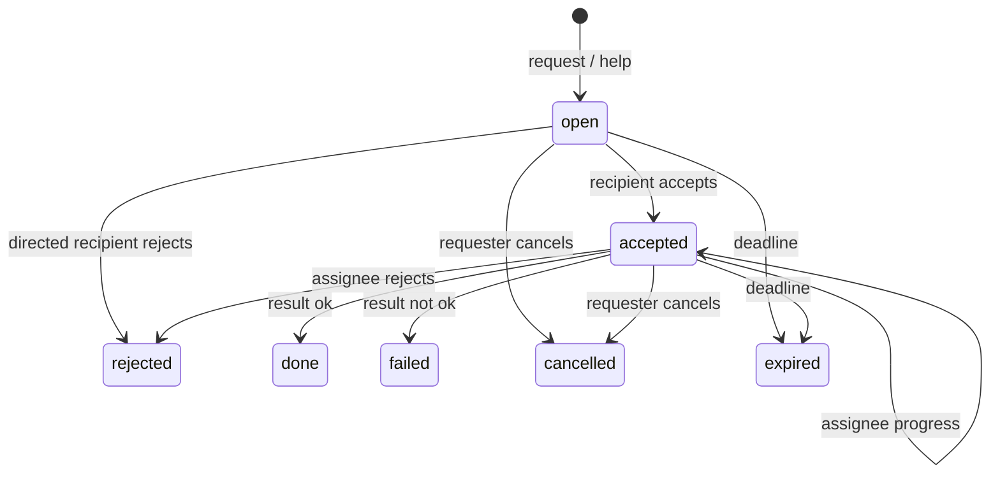

# Generaloid comms protocol v1

HTTP JSON, UTF-8. The hub chooses version 1 from a peer's `protocol_versions`; incompatible versions receive 426.
Every endpoint except `GET /health` requires a bearer credential. The join credential and session credential are
different. API errors are `{"ok":false,"error":"..."}` with 400 schema/JSON, 401 authentication, 403 authority,
404 unknown peer/request, 409 lifecycle/identity/id conflict, 413 body cap, 426 version, or 429 rate limit.

## Handshake and heartbeat

`POST /v1/join`, `Authorization: Bearer <shared token or this robot's key>`:

```json
{"hello":{"robot_id":"so101-b","connector":"so101","display_name":"SO-101 B",
 "agent":"local planner","protocol_versions":[1],"capabilities":["5dof-arm","gripper"],
 "skills":["gripper","move_tcp"],"frames":{"world":"table-aruco-0","units":"m",
 "convention":"right-handed, z up","base_in_world":{"frame":"world","xyz":[0,0.3,0]}},
 "reach":{"max_radius":0.35}}}
```

Robot ids match `[a-z0-9][a-z0-9_.-]{1,47}`; `hub` is reserved. Response includes a newly generated `session`, roster,
`cursor`, `resumed`, `rejoined` and hub limits. To resume, add `"resume":"<previous session>"` beside `hello`, using
the join credential again. Live duplicate ids are rejected unless the old session is presented. A stale id may be
reclaimed by an authorized joiner; per-peer keys bind this right to one identity. A resume rotates the session key.

`POST /v1/heartbeat` with `{"status":{"state":"waiting"}}` refreshes liveness and descriptive status. Every
other authenticated call also refreshes liveness; an active long-poll/SSE connection counts as alive. Default
stale/drop thresholds are 45/300 seconds. Built-in clients long-poll, so separate heartbeat traffic is unnecessary.

## Message envelope

`POST /v1/send`, `Authorization: Bearer <session>`:

```json
{"v":1,"id":"0123456789abcdef0123456789abcdef","kind":"request","to":"elrobot-a","re":null,
 "payload":{"task":"hold_bottle","prompt":"hold the body while I unscrew","args":{"duration_s":30},"ttl_s":120}}
```

`id` is 8–64 ASCII letters/digits/underscore/hyphen; UUID4 hex is recommended. `re` references the original request
id. The hub stamps authenticated `from`, hub-clock `ts` (Unix seconds) and recipient-specific `seq`; claimed sender
fields are discarded. ACK returns id, timestamp, `delivered_to` and lifecycle state if applicable. Delivery means
queued, not read, accepted or executed. All JSON numbers must be finite.

| Kind | Payload / rules |
| --- | --- |
| `request` | Required `task` (200 chars); optional `prompt` (4000), `args` object, `requires` string list, `ttl_s`; one recipient |
| `help` | Required `problem`; optional `ask`, `context` object, `args`, `ttl_s`; one recipient or `*` |
| `accept` | Optional `note`, `eta_s`; recipient replies to requester with `re` |
| `reject` | Required `reason`; same addressing |
| `progress` | Optional `fraction` in [0,1], `stage`, `note`; only accepted assignee |
| `result` | Required boolean `ok`; optional `summary`, `data` object; only accepted assignee |
| `cancel` | Optional `reason`; only requester; hub routes it to original recipient(s) |
| `observation` | At least one of `images`, `poses`, `note` |
| `status` | Required `state`; optional `note` |
| `message` | Required `text`; task/prompt text without opening a lifecycle |

Text fields are capped at 4000 characters unless otherwise stated. Requests default to a 120 s TTL; permitted range
1–3600 s. The hub computes the absolute deadline using its own clock. `requires`, capabilities, and frames are
informational; the local agent must check them. A handoff uses a new request with task/prompt and arguments such
as the completed request id and object pose; there is no implicit transfer of a motion lock.

Images: `{"mime":"image/jpeg","data_b64":"...","camera":"wrist"}` (JPEG/PNG/WebP, valid base64), or
`{"url":"https://.../frame.jpg"}`. Optional timestamps/dimensions/camera labels are metadata. URLs are delivered
as references and never fetched automatically. The MCP tool accepts local JPEG/PNG `path` entries, validates magic
bytes, and attempts Pillow resizing above 96 KiB. Peer-supplied paths never trigger local file reads.

Poses: `{"name":"bottle","frame":"table-aruco-0","xyz":[0.21,0.02,0],"quat_xyzw":[0,0,0,1]}`.
Positions are metres, right-handed; quaternion ordering is xyzw. `ts` may record capture time. Shared frame names
are only meaningful after independent calibration of both bases into the same world. The hub validates shape,
not calibration or normalized quaternions. Never treat matching string names as proof of alignment.

## Lifecycle and reliability



Terminal states cannot transition. Broadcast help remains open after a candidate's rejection; first acceptance
wins atomically on the hub event loop. Other candidates receive `request_claimed` with `re` and `assignee`.
Only that assignee can progress/finish. The hub emits `expired` to both sides (all candidates for unclaimed
broadcast help). Other system kinds: `peer_joined`, `peer_left`. Cancel/expiry does not physically stop a robot.

`GET /v1/inbox?since=0&wait=20&limit=100` returns messages, cursor and cumulative dropped count. `since` both selects
new messages and acknowledges all older ones. Wait is capped at 25 s; limit 1–1000. Mailboxes retain 1000 messages,
dropping oldest on overflow. Default clients retain 2000 local messages and 10000 dedup ids. Sequences/gaps and
`dropped` expose loss to raw clients. The MCP inbox exposes only locally retained messages; consult the hub and
reconcile tasks after long outages rather than assuming a full history.

`GET /v1/stream?since=...` is the optional SSE equivalent (`Last-Event-ID` supported; event id is mailbox seq).
Use one consumer per robot. Quick Tunnels do not support SSE; built-in clients always use long-polling.

Identical retries with the same `(sender,id)` return the original ACK with `duplicate:true`. Changed content under
that id receives 409. The hub retains 20000 ids; this is a bounded idempotency window. Clients reuse ids across
network retries, back off from 0.5 to 10 s on receive failures and rejoin after a session 401. Completed requests
stay queryable for 600 s. Restart loses all runtime state; in-flight retries may become fresh messages. Never infer
exactly-once physical execution from an ACK. Use task-level checks before repeating any motion.

`GET /v1/peers`, `/v1/requests`, `/v1/log?limit=200`, and `POST /v1/leave` provide roster, authorized task views,
peer-scoped recent audit events and explicit departure. Disk JSONL strips inline image bytes and never stores
join/session credentials. Request payloads and peer text remain sensitive data.
