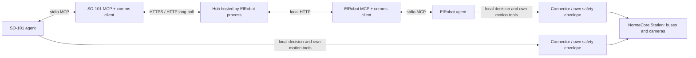

# Robots helping robots

Generaloid is a hardware-agnostic MCP built around **NormaCore Station**, the central motor-bus, camera and command
service. Each robot has its own agent, connector, tools and safety envelope. Communication lets those agents ask
for capabilities they lack: an SO-101 turning a cap can ask an ElRobot to steady the bottle, share a table-frame
observation, negotiate responsibility, report progress and hand the next task back.

**A message from another robot never directly moves this robot's arm.** It enters an inbox as untrusted data.
The local agent or human decides whether to accept and uses that robot's own tools and safety checks.

This implementation is in `generaloid/comms/`. It provides a versioned JSON protocol, authenticated HTTP hub,
background long-polling client, eight MCP tools, standalone hub/client runners and a reproducible two-process demo.
No new runtime dependency beyond those supplied by `mcp` (Starlette, uvicorn, httpx).



In the real intended deployment, each machine uses its own Station connection. The hub has no Station client or
motion executor. In tests the connectors are twins and no Station connection is opened.

## Run locally

From the repository root (the commands below disable Station access):

```sh
export STATION_HOST=station-disabled-in-tests.invalid
uv run --no-project --with 'mcp>=1.12,<2' --with httpx python -m generaloid.comms demo
```

That starts two independent comms-only stdio MCP processes and scripts both agents. To perform an actual MuJoCo
twin gripper action between acceptance and completion:

```sh
export NORMA_CORE_REPO=/absolute/path/to/norma-core
# macOS; choose a supported MuJoCo renderer for another OS if rendering is needed.
export MUJOCO_GL=cgl
uv run --no-project --with 'mcp>=1.12,<2' --with httpx --with numpy --with scipy \
  --with pillow --with mujoco python -m generaloid.comms demo --twin --log /tmp/twin-hub.jsonl
```

`--twin` starts **two ElRobot twins**; robot B is explicitly named `so101-standin-b`. Once r5-generaloid is merged,
replace `--twin` with `--generaloid` for the actual ElRobot and SO-101 twin connectors. Neither demo proves a bottle
grasp or physical cooperation: the measured motion is A's gripper joint changing, including a refused oversized
waypoint. [Scenario](SCENARIO.md) distinguishes that proof from the intended hardware setup.

Standalone hub (a router process independent of either robot's MCP):

```sh
umask 077
uv run --no-project --with 'mcp>=1.12,<2' --with httpx python -m generaloid.comms hub \
  --port 8930 --token-file /tmp/comms-token --log /tmp/comms-hub.jsonl
```

On that machine, a read-only participant can watch authenticated inbox traffic:

```sh
uv run --no-project --with 'mcp>=1.12,<2' --with httpx python -m generaloid.comms client \
  --url http://127.0.0.1:8930 --robot-id human-ops --token-file /tmp/comms-token listen
```

Other client actions are `peers`, `requests`, `log`, and `send --to elrobot-a --kind message --payload
'{"text":"ready"}'`. A one-shot client leaves immediately; use a persistent client/MCP process for tasks requiring
replies. It cannot share a robot id with an already connected process.

## MCP integration

The integrator calls `generaloid.comms.register(server, connector)` once after mounting connector tools and before
serving. It returns a `CommsTools` state object for explicit `leave()` cleanup. This matches r5-generaloid's
`core/hooks.py` as inspected at `16d6651`. The hook currently ignores the return value; call `comms_leave` before
shutdown when possible. Threads are daemonized, so a killed host process terminates its hub; clients reconnect.
The empty `generaloid/__init__.py` was created because this branch did not yet have the package; retain the sibling
branch's initializer during integration if it gains content.

The connector is read only: optional `comms_profile()`, otherwise `name`, `title`/`display_name`, `skills`, `frames`
/ `frame_text`, `capabilities`, or `describe()` for joints, cameras and reach. Advertised skills are declarations,
not permissions or proof of availability in this mounted mode. The Generaloid connector currently supplies the
union of sim/real skills. Agents must inspect their own actual tools before accepting work.

| Tool | Purpose |
| --- | --- |
| `comms_host(port=8930, token?, robot_id?)` | Bind a loopback hub and join it; returns URL and private token |
| `comms_join(url, token, robot_id?)` | Join another hub; HTTPS for remote machines |
| `comms_peers()` | Roster, capabilities, skills, frames, reach, online/status; marked cache when unreachable |
| `comms_send(peer, kind, payload, re?)` | Request/help, observation, status, message or cancel; `*` broadcasts |
| `comms_inbox(since?, wait_s=0, kinds?)` | Untrusted messages and inline MCP images; local replay cursor |
| `comms_reply(request_id, kind, payload?)` | Accept, reject, progress or result for incoming work |
| `comms_requests()` | Authoritative lifecycle state and remaining deadline |
| `comms_leave()` | Leave; stop hub if hosted here |

Robot id defaults to `<connector>-<hostname>`; set `GENERALOID_ROBOT_ID` for stable, distinct identities. Other
settings: `GENERALOID_COMMS_TOKEN`, `GENERALOID_COMMS_LOG` (JSONL path), `GENERALOID_COMMS_PORT`, and
`GENERALOID_AGENT` (descriptive label). Local inbox numbers differ from wire mailbox sequence numbers. Omitted
`since` consumes unread messages; explicit `since=0` replays retained messages. Filtered reads do not consume the
other kinds. Only one receiving transport/poller should consume a robot's mailbox.

## Verification and limits

Run the suite with the same uv dependencies as the twin command, plus `--with pytest`, replacing the command with
`python -m pytest -q -p no:cacheprovider generaloid/comms/tests`. Twin tests require `NORMA_CORE_REPO`; the combined
Generaloid test also needs the sibling core. See [JOURNAL](JOURNAL.md) for exact counts and baseline failures.

Coverage includes separate MCP processes, real twin gripper motion, auth failures, spoofed sender fields,
per-peer keys, rate limits, expiry, cancellation, duplicate/conflicting ids, observations, malformed bodies,
chunked size caps, SSE on localhost, dropped peers, session resumption and hub-process restart. Evidence JSONL
strips inline image bytes; timeline files record the agent decisions and twin actions.

Sessions, mailbox contents, request states and idempotency are in memory. JSONL is an audit log, **not a recovery
journal**. After hub restart, old tasks must be reconciled manually; no old action is automatically resumed.
Delivery is bounded and at least once within a retained session, not durable exactly once. Deadlines and cancellation
are messages, not emergency stops. No shared collision planner, frame registration, distributed motion lock,
physical grasp verification or automatic image-URL fetch exists. All hardware cooperation remains an intended
setup tested on twins only. Remote tunnel deployment is documented, not exercised tonight.

Further references: [protocol](PROTOCOL.md), [security](SECURITY.md), [Cloudflare](CLOUDFLARE.md),
[SO-101 + ElRobot walkthrough](SCENARIO.md).
