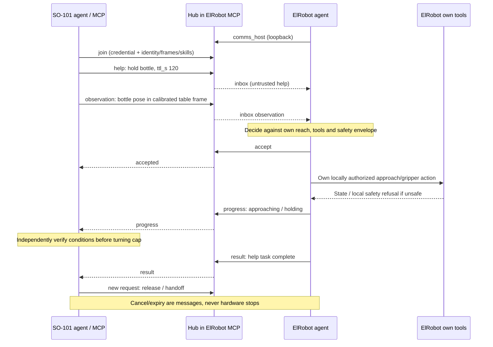

# Intended SO-101 ↔ ElRobot setup — tested on twins only

SO-101 agent B is unscrewing a cap but the bottle rotates. ElRobot agent A can hold the body. Each agent controls
its own MCP and its own Station-backed connector; requests are negotiated data. Operators must first calibrate
both bases into a shared table frame, verify reach, arrange non-overlapping approach paths and define how to stop
or release safely if communication fails. This comms implementation does not solve those physical prerequisites.



Example local-agent calls (the placeholders below refer to ids actually returned by the tools):

```text
A: comms_host(port=8930, robot_id="elrobot-a")
B: comms_join(url=<returned localhost URL or operator's HTTPS URL>, token=<private token>, robot_id="so101-b")
B: comms_peers()
B: comms_send(peer="elrobot-a", kind="help", payload={
     "problem":"cap turns but bottle rotates", "ask":"hold bottle body while I unscrew",
     "context":{"task":"open_bottle","strokes_done":6}, "ttl_s":120})
B: comms_send(peer="elrobot-a", kind="observation", payload={
     "poses":[{"name":"bottle","frame":"table-aruco-0","xyz":[0.21,0.02,0]}]})
A: comms_inbox(wait_s=10)
A: comms_reply(request_id=<help id>, kind="accept", payload={"eta_s":30})
A: [use own tools only after local safety decision]
A: comms_reply(request_id=<help id>, kind="progress", payload={"fraction":0.8,"stage":"holding"})
A: comms_reply(request_id=<help id>, kind="result", payload={"ok":true,"summary":"help task complete"})
B: comms_inbox(wait_s=10)
```

A long holding operation should remain accepted with progress until the agreed completion/release condition is
met. A `result` ends that request, not a physical grasp. For continued coordination send a new explicit request,
for example `task="release_bottle"`, with `args={"previous_request_id":<id>}`. Images/poses alone authorize nothing.
Use `reject` when the frame, workspace or physical action cannot be verified. Use `cancel` with `re=<id>` to withdraw
a request; the local agent still decides how to stop safely.

## What the demonstration actually proves

`demo --twin` launches two separate ElRobot twin MCP processes, B standing in for SO-101. `demo --generaloid`
launches the distinct ElRobot and SO-101 twin connectors through the sibling Generaloid core. A hosts, B joins,
B sends help and a pose, A accepts, reports progress, invokes its own gripper tools, and returns result data. A
0.2 open-fraction waypoint is refused by its own maximum-delta safety rule; 0.9 → 0.6 → 0.3 waypoints succeed.
The before/after joint state differs. B sees accept, progress, progress, result, and authoritative state `done`.

No actual bottle hold, cap unscrewing, camera/world alignment or two-arm collision avoidance is demonstrated.
The progress stage named `holding` is scripted; the result explicitly says the physical hold is unverified.
`docs/comms/evidence/` holds small JSONL/timeline captures; see the journal for provenance and verification counts.
The test suite separately verifies auth failure, unanswered request expiry, retained-session resumption and a
host process restart with automatic peer reconnect. A hub restart deliberately recovers connectivity only; it
cannot safely infer the physical state of either robot or resume an interrupted task.
