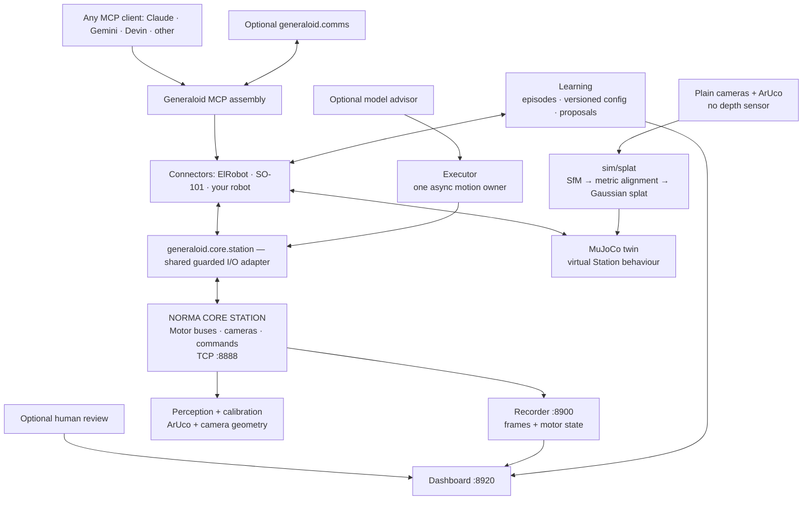

# Architecture: NormaCore at the centre



NormaCore Station owns actual motor-bus and camera-device I/O. Generaloid neither opens serial ports nor captures USB devices. `core.station.Station` supplies motor-bus and camera-queue adapters and one guarded `connect()` helper. On real mounts, `Station.install()` routes the legacy bus and twin camera adapter's connection functions through that object. The real server receives camera frames through the existing relay, whose producer reads Station queues. Recording remains the existing separate Station consumer, not a new recording implementation inside the MCP process.

`connect()` reads `STATION_HOST` at call time, defaulting to `localhost`, and refuses under pytest unless the explicit live-test opt-in is present. It detects both imported pytest and `PYTEST_CURRENT_TEST` in child processes. Tests never enable that opt-in. The guard applies to Generaloid-routed connections; standalone legacy entry points retain their existing behaviour and the repo test host guard. The five owned scripts now read `STATION_HOST` too.

## Connector boundary

`connectors.base.Connector` declares joints/motor IDs, gripper direction and width, camera roles/Station IDs, safety envelope, kinematics, twin construction and skills per mode. `mount(mode, station)` returns a `Mount`: registered FastMCP tools, the backing robot and a close callback. `frame_for(mode)` gives mode-specific coordinates. Server assembly only understands this interface; it has no robot-name branches.

`ProfileConnector` reads existing profiles without duplicating calibration numbers. ElRobot imports the existing servers and copies their registered Tool objects into the Generaloid server. Schemas, descriptions, annotations and function objects are retained. Private FastMCP ToolManager APIs are isolated in `core.server.adopt_tools`; the supported dependency is MCP 1.x (`>=1.12,<2`) and parity tests catch changes.

SO-101 uses a generic twin because the existing ElRobot twin hard-codes eight actuators and a particular gripper. The new twin is isolated in `generaloid/twin`, reuses the scene builder, profile declarations and learning config, and exposes nine motion/observation tools plus scene reset and skill config. It does not claim bottle-twist skill support. Generic IK uses actuator joint addresses, a `grasp_tcp` site (+y approach, +x closing direction), and the shared least-lean search.

The SO-101 scene imports NormaCore's follower URDF and meshes, based on `origin/simulation_s101`; its real profile comes from `origin/robot-profiles`. The twin's +y-forward frame and real profile's +x-forward frame are explicitly distinguished. They are **not yet a calibrated sim-to-real pair**. `hardware_verified=False` records this limitation; it is metadata, not a hardware interlock.

## Module facade, not a rewrite

`generaloid.modules.MODULES` records current paths, roles and entry points; `modules.load(name)` imports existing implementations lazily. ElRobot twin and real tools, `learning/`, `executor/`, `recorder/`, `dashboard/`, perception, calibration and `sim/splat/` stay where they are. Optional Gemini advisors and dashboard approval workflows surround the core rather than gating MCP operation.

The Gaussian splat pipeline takes ordinary video, extracts frames, estimates camera poses with SfM, aligns ArUco corners to the twin's metric frame, then trains a Gaussian splat. It needs no depth sensor. It is a visual reconstruction pipeline; MuJoCo remains responsible for collision geometry and physics. This run wrapped/documented it without retraining a splat.

## Comms integration contract

After connector tools are installed and before serving, assembly calls:

```python
# Implemented by the independently owned generaloid/comms package:
def register(server: FastMCP, connector: Connector) -> None: ...
```

The signature is exported as `CommsRegister` from `connectors.base` and defined in `core.hooks`. The synchronous hook may add tools/resources and read public connector metadata. It is called once per assembled server. An absent module is skipped quietly. A missing dependency, missing callable or raised exception is reported on stderr and in `mount.addons`, preserving robot tools and stdout's MCP protocol. A hook that mutates tools before raising is not rolled back; add-ons should register atomically and avoid replacing existing robot tools. `--no-addons` disables it. No files under `generaloid/comms/` were created or edited here.

## Process and lifecycle limits

Run one connector per server process. Legacy servers capture globals at import time; switching environment variables or mounting them repeatedly does not reconstruct their robot. A cached real server belonging to another connector is rejected. Generic twin close stops and joins physics and releases the renderer. SO-101 construction temporarily swaps two scene-builder callbacks and restores them in `finally`; build scenes serially, not concurrently in a shared process. The generic twin is a test/simulation backend, not a replacement for the executor's production arbitration.
