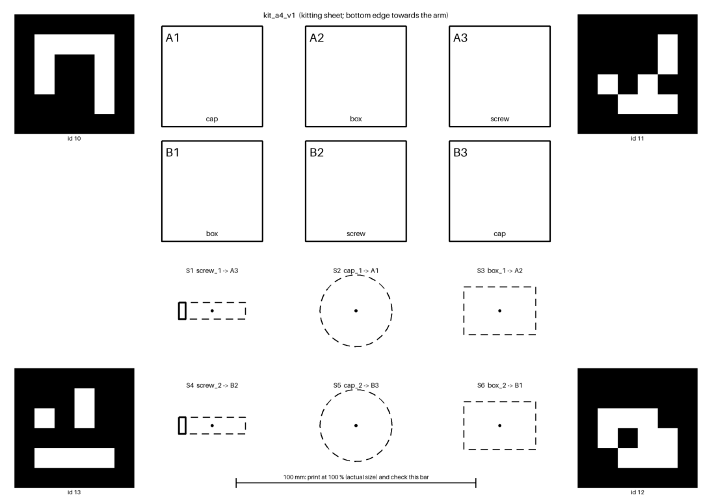
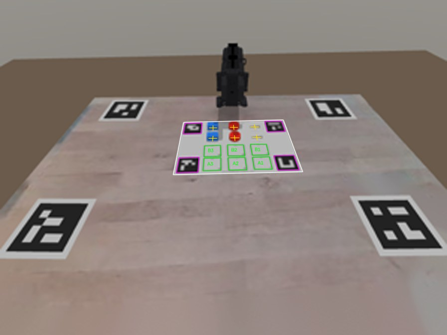

# Kitting learned in the digital twin

The task takes six small parts from printed start outlines to six labelled target cells on an A4 sheet. A single
JSON spec, `tasks/kitting/kit_a4.json`, defines the paper, markers, cells, object geometry/masses and assignments.
Change the `cells` list and `grid.cell_size` to change count, labels and dimensions; update assignments/start spots
with it. `Spec.load` checks printable bounds, cell/marker overlap and assignment uniqueness. Explicit centres are
authoritative; the grid's row/column lists describe the default, rather than implicitly generating geometry.

NormaCore Station is the platform's hardware gateway. Kitting trains without a Station connection. The hardware
handoff uses the existing executor and its Station backend; nothing here sends servo commands to the live robot.

```mermaid
flowchart LR
    JSON[Sheet JSON spec] --> Print[A4 PDF / PNG]
    JSON --> Scene[Calibrated home twin + kit objects]
    Scene --> Image[Rendered overview]
    Image --> Locate[ArUco rays to table / rigid fit]
    Locate --> Plan[Shared pick-place planner]
    Config[Versioned per-class profile] --> Plan
    Plan --> Physics[MuJoCo contact physics]
    Physics --> Judge[Final footprint / error / diagnosis]
    Judge --> Episodes[EpisodeStore journal]
    Episodes --> Rule[Scripted diagnosis rules]
    Rule --> AB[Paired twin A/B checks]
    AB --> Config
    Config --> Real[Executor proposals through NormaCore Station]
```



## What was built

- A4 landscape, four 50 mm DICT_4X4_50 markers (10–13), six 42 mm cells and six printed start outlines. A 100 mm bar
  checks print scale. PDF declares exactly 297×210 mm with lossless 300 dpi artwork.
- A calibrated `home.json` derivative with 3.3 g screw assemblies, 2.5 g caps, 6 g boxes, a textured sheet and task-local
  pad correction. `sim/build_scene.py` is unchanged. The visual paper has no additional collision surface; objects
  contact the calibrated tabletop, a submillimetre approximation.
- Sheet localization: detected marker corners → calibrated camera rays → sheet-height plane → rigid 2D fit. The same
  implementation reads real distorted images and twin pinhole images. It returns table-frame cell centres and an
  overlay, plus residual and pixel-noise uncertainty. Multi-scale decoding helps the tiny overview markers.
- Rule-driven per-class improvement of grasp/approach height, force, yaw, place height and release opening. Policies
  use the located sheet plus known spots, joints and jaw/load readings. The judge uses ground truth and supplies
  diagnoses to the proposer; this privileged sim feedback must be replaced by operator/vision evidence on hardware.
- Episode JSONL (`episode_begin`, object phases, judges, `episode_end`) and per-attempt reports reuse EpisodeStore
  storage. Config changes use `skillcfg.propose/update_proposal/apply/reject`; each proposal has a paired check.
- Exported JSON profile and an operator-gated real runner reading the same numbers and shared plan.

## Reproduce

Use the dependency function in [REAL_RUN](../../tasks/kitting/REAL_RUN.md). For all offline work:

```bash
export STATION_HOST=station-disabled-in-tests.invalid
export MUJOCO_GL=cgl
export DATA_ROOT='/Volumes/Dell HDD/Robotics-Hackathon'
kitpy -m tasks.kitting.sheet --out "$DATA_ROOT/r5-kitsim/print"
KIT_RENDERER=cpu kitpy -m tasks.kitting.learn --iterations 8 --episodes 3 --check-seeds 2 \
  --test-episodes 6 --out "$DATA_ROOT/r5-kitsim/runs/new-run" --export
```

Use a fresh output directory. Without `KIT_RENDERER=cpu`, the calibrated MuJoCo GL render is used. In this sandbox
GL fails with `invalid CoreGraphics connection`; CPU mode projects the same printed texture and object silhouettes
from MuJoCo camera/model data. It lacks arm occlusion/shadows and only varies ambient brightness, so the measured
curve has narrower visual validity than a full GL randomized run. Geometry, dynamics, masses, friction, camera pose,
arm calibration and object placement still vary. The `nice` priority change was blocked; no more than one training
job was run at once.

The fast training controller is task-local, based on twin/executor primitives, rather than the executor's motion
thread. `tasks/kitting/executor_sim.py` adapts the same physics to the executor's backend contract for a handoff check.
These two controllers are not assumed equivalent. See [results](RESULTS.md) for measured evidence and limitations.

## Randomization and evaluation

Each full episode resets the sheet (±25 mm x, ±20 mm y, ±10° yaw), objects (3 mm normal position noise clipped at
8 mm; 6° yaw), camera (3 mm position, 0.4° rotation normal noise), arm calibration (2 mm / 0.4° normal bias), masses
(0.8–1.25×), friction (0.7–1.3×) and light parameters. Normal distributions are not hard safety envelopes.
Evaluation seeds start at 10000 and repeat each iteration; proposal-check seeds start at 50000; held-out seeds
start at 90000. Each class proposal changes at most one parameter, with at most two proposals per iteration.

Success means the complete rotated footprint is inside the cell and resting flat, judged again at the end of the
whole kit. Error is Euclidean centre distance in mm. Mean error over successful objects excludes misses, so always
read it with success rate and complete-kit count. Aborted localization/numerical failures count all intended
assignments as failed. Numerical warnings invalidate the episode instead of accepting MuJoCo's implicit reset.
A/B proposals can improve a diagnosis without yet placing an object; lowering release can also pass if drop height
improves by >2 mm, placed count does not decrease, and mean placed error worsens by <=1 mm. This is a heuristic
search with small checks, not a statistical guarantee of generalization.

## Transfer and remaining risk

Follow [the real checklist](../../tasks/kitting/REAL_RUN.md). Starts are deliberately fixture-like: the screw is
about a pixel wide, so arbitrary loose-object localization is not solved. Actual screw heads/threads, pad friction,
cap hollow walls and motor torque response differ from these simple models. Camera-to-base systematic error may
be larger than randomized error. A single marker is allowed in training, but the real runner requires two.

The public learning registry has no registration hook on this branch. `profile.register` inserts documented key
schema dictionaries into `skillcfg.registry()` at runtime, without editing `learning/` or calling `_key`. EpisodeStore
subclassing uses its existing storage helpers. The integrator should reconcile this with r5-skills' API and retest.
Per-class keys stay in a task-local `SKILLCFG_DIR`; bottle config is untouched. No cloud operator was added: the
scripted loop stands alone.

## Verification

```bash
STATION_HOST=station-disabled-in-tests.invalid \
NORMA_CORE_REPO=/Users/bodha/Documents/b0dha/Robotics-Hackathon/repo/norma-core MUJOCO_GL=cgl \
uv run --no-project -q --with pytest --with numpy --with scipy --with pillow --with reportlab \
  --with mujoco --with opencv-contrib-python --with 'mcp>=1.12,<2' --with httpx \
  python -m pytest -q -p no:cacheprovider tasks/tests/test_kitting.py
```

The 13 task tests pass without a GL connection or Station. The full common suite passed 278 tests before these
changes and 291 afterward; both runs had the same six failures, three errors and one skip in this sandbox. Existing
GL-dependent executor/bottle tests fail because no CoreGraphics connection is available; the marker/table preflight
failure is also pre-existing. The extra required Python dependency for the printable sheet is `reportlab`.





## Final measured outcome and recovery

The selected profile completed **2/2 nominal kits (12/12 objects)**. Under the specified randomization it placed
**13/36 objects (36.1%)**, versus **9/36 (25%)** for generic parameters; neither profile completed a randomized kit.
Mean placed-object error was 5.58 mm versus 6.21 mm. The selected fixed evaluation improved from 6/18 to 9/18,
5.70 to 4.53 mm. The two nominal trials repeat an identical scene; they do not establish robustness.

Randomized held-out sheet-pose error averaged 6.39 mm, already comparable to the 6 mm clearance around a cap in a
42 mm cell. Better camera/base calibration, marker-based table recalibration and a more global search are the next
priorities. The local rule search did not establish that yaw 0 is optimal; rejecting intermediate yaw changes can
trap it in a local solution. This profile is a candidate for supervised transfer, not an unattended real kitting skill.

The external drive disconnected during final evaluation. The historical curve was recovered from completed console
lines and is labelled accordingly. All scores above were freshly reproduced under `/tmp/r5-kitsim-rescue`; the 22
fresh episodes (1,072 records) are compressed in `evidence/recovery_episodes.jsonl.gz`. Original tuning proposal logs
remain on the disconnected drive if recovered later. The delivered profile is reconstructed from the selected values
and reverified; its recovery skillcfg version is 1, corresponding to original selected v11/restored v14.

Persistent deliverables: [printable PDF](../../tasks/kitting/print/kit_a4_v1.pdf),
[300 dpi PNG](../../tasks/kitting/print/kit_a4_v1.png),
[candidate profile](../../tasks/kitting/profiles/kit_learned.json), [numbers and curve](RESULTS.md),
and [operator checklist](../../tasks/kitting/REAL_RUN.md). For a host without the external drive, set `DATA_ROOT=/tmp`
explicitly while testing. The report command can read either a normal completed run or the recovery results.
