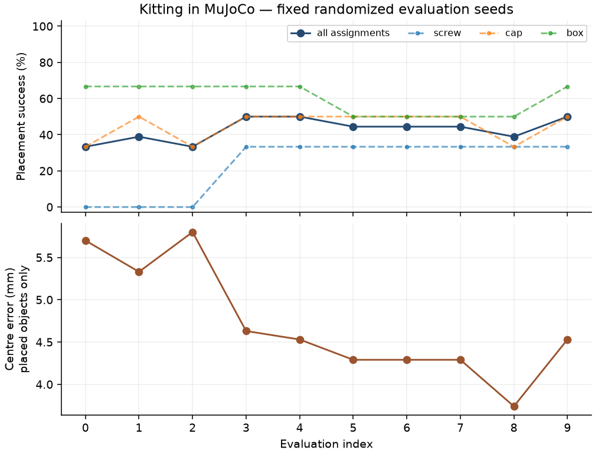
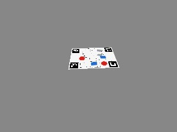
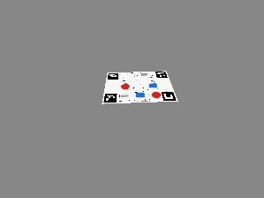

# Measured kitting results

Source: `/tmp/r5-kitsim-rescue`. Renderer: `cpu`. Runtime accounting: interrupted; see journal.

This is a scripted heuristic search with privileged simulation diagnoses. No real-arm success is claimed.

Historical curve transcribed from completed console output after external drive disconnect; held-out and replay metrics freshly verified locally

The exported profile is selected by fixed evaluation success, with lower placed error breaking ties, before the learned held-out score is read. The recovery run replays selection at index 9 and uses a new config version lineage.

| iteration | version | placed / attempted | complete kits | placed error mm | screw | cap | box |
|---|---|---|---|---|---|---|---|
| 0 | 0 | 6/18 (33.3%) | 0/3 | 5.7 | 0.0% | 33.3% | 66.7% |
| 1 | 3 | 7/18 (38.9%) | 0/3 | 5.33 | 0.0% | 50.0% | 66.7% |
| 2 | 5 | 6/18 (33.3%) | 0/3 | 5.8 | 0.0% | 33.3% | 66.7% |
| 3 | 10 | 9/18 (50.0%) | 0/3 | 4.63 | 33.3% | 50.0% | 66.7% |
| 4 | 11 | 9/18 (50.0%) | 0/3 | 4.53 | 33.3% | 50.0% | 66.7% |
| 5 | 12 | 8/18 (44.4%) | 0/3 | 4.29 | 33.3% | 50.0% | 50.0% |
| 6 | 12 | 8/18 (44.4%) | 0/3 | 4.29 | 33.3% | 50.0% | 50.0% |
| 7 | 12 | 8/18 (44.4%) | 0/3 | 4.29 | 33.3% | 50.0% | 50.0% |
| 8 | 13 | 7/18 (38.9%) | 0/3 | 3.74 | 33.3% | 33.3% | 50.0% |
| 9 | 14 | 9/18 (50.0%) | 0/3 | 4.53 | 33.3% | 50.0% | 66.7% |

Three kits per fixed-seed iteration are a small sample, not a confidence interval. The same kits repeat; iterations are not independent trials. Read the held-out comparison separately. Per-class rates describe executed objects; overall rates include aborted kits as failures.

## Held-out comparison

| profile / condition | placed rate | complete kits | mean placed error mm | aborted kits |
|---|---|---|---|---|
| generic_randomized | 25.0% | 0/6 | 6.21 | 0 |
| generic_nominal | 50.0% | 0/2 | 5.2 | 0 |
| learned_randomized | 36.1% | 0/6 | 5.58 | 0 |
| learned_nominal | 100.0% | 2/2 | 4.83 | 0 |

## Changes accepted during search (later changes can be reverted)

- After iteration 0: screw.grasp_z_mm 18->15
- After iteration 0: cap.place_z_mm 40->32
- After iteration 0: box.place_z_mm 40->32
- After iteration 1: cap.place_z_mm 32->24
- After iteration 1: box.place_z_mm 32->24
- After iteration 2: screw.grasp_z_mm 15->14
- After iteration 2: cap.place_z_mm 24->19
- After iteration 3: box.place_z_mm 24->21.5
- After iteration 4: box.place_z_mm 21.5->19
- After iteration 7: cap.grasp_z_mm 18->17

## Images and provenance

These are final states of the first evaluation seed before/after training. CPU projections omit arm occlusion and shadows. The separately stored `images/devin_gl_overview.png` was generated by Devin before this takeover at 640×480; the perception test downsamples it to deployment resolution (299×224).

The original episode reports and proposal evidence were on the external drive when it disconnected. Fresh recovery episode records are under the local run directory, and all 22 fresh episodes are archived in `evidence/recovery_episodes.jsonl.gz`. Nominal kits repeat the same scene; they are not independent robustness trials. `measurements.json` is a small in-repo copy of the aggregate data. See README and REAL_RUN for transfer risks and exact commands.
