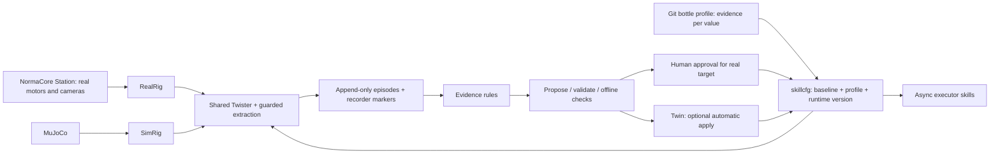

# Reading and changing a learned skill

The real arm opened a bottle through NormaCore Station, which remains the central motor bus and camera owner.
The skill layer records what those attempts taught it. Both MCP servers import the same `learning.tools`,
`Twister`, free-signal detector, and versioned configuration reader; the executor uses that reader too.



`learning/profiles/bottle_cap.json` version 1 contains the learned bottle settings. An entry has a `value`,
`baseline`, source `attempts`, `date`, and a sentence explaining the evidence. Object dimensions and the estimated
350° thread travel live beside those entries. A reference to an attempt is evidence, not a claim that the parameter
was isolated in a controlled experiment. The 12 trials include moved bottles, partially loosened caps, and faults.

Precedence: registry baselines < selected learned profiles < runtime target version. `SKILL_PROFILES=bottle_cap`
selects this profile explicitly; unset selects checked-in profiles; `SKILL_PROFILES=none` gives the unchanged r4
baselines. `SKILLCFG_DIR` selects storage, separately for `real` and `twin`. Keep test/scratch storage separate from
live logs. Values are read at call time; each Twister takes one snapshot for that call. Profile file changes are
picked up by the mtime cache. A change to registry code requires a server restart.

`episode_begin({})` inherits the previous attempt, or profile defaults on a fresh store. Applied changes to
`params.default.*` take precedence over inherited parameters on the next attempt; explicit caller parameters win.
The three-parameter attribution limit still applies. Each begin records `skillcfg`, `skill_profile`, and the actual
`skill_defaults` snapshot, so subsequent profile edits can be distinguished from per-attempt overrides. Do not
change configuration in the middle of an attempt: attribution is per begin, while readers refresh between calls.

Use the MCP `skill_config` and `propose_skill_change` tools to inspect and propose. `episode_end` runs rules that
record proposals with the supporting lesson and measurements, using the same r4 `SC.propose` and `run_checks` flow.
`learn.auto_propose=off` disables these proposals; `learn.auto_apply=off` is the default. With it on, only the twin
may auto-apply. Real hardware approval remains a separate human CLI action; neither MCP server offers a real apply
tool. Types, bounds, and safety class are validated. Optional twin checks are additional evidence; validation alone
is not proof that a proposed strategy improves the task.

Run commands using the dependencies in `r5-common.md`, with `uv run --no-project ... python` as the prefix:

```sh
python -m learning.skillcfg show --target twin
python -m learning.skillcfg propose params.default.strokes=15 --reason 'lift resisted after 11 strokes' --evidence 'attempt N extract phase' --target twin
python -m learning.skillcfg revert twin 0 --by operator --reason 'restore learned bottle profile'
```

For real approval, a human runs `python -m learning.skillcfg approve <id> --by <name>` after reviewing evidence and
checks. Revert creates a new append-only version, preserving the old history. Reverting to version 0 restores the
currently selected profile, **not** the pre-learning baselines. To restore a historical profile itself, restore its
JSON from the intended git revision, then review runtime overrides. Set `SKILL_PROFILES=none` only for an explicit
baseline experiment. Changing a profile is a reviewed source change, not a way for the learning rules to bypass
approval or safety limits.

Fixed safety limits (`episodes.SAFETY`, workspace, load aborts, gripper geometry and IK branch-jump guard) remain
immutable through proposals and profile overlays. Learned settings can never raise those limits. The learned
22 mm cap height is essential: the -6.5 mm depth is only 0.5 mm above the fingertip floor on that object. Re-measure
height when changing bottles.
