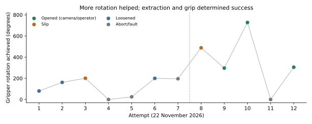

# The bottle learning curve

Source: all 367 events in `logs/learning/bottle/episodes.jsonl` and its `SUMMARY.md`, 22 November 2026. The source logs are unchanged. [Curated measurements](data/attempts.json) retain parameters, relevant phases, stroke loads and lessons for all twelve attempts.

| Attempt | torque | depth offset mm | stroke ° × budget | speed | achieved ° | outcome |
|---|---:|---:|---|---|---:|---|
| 1 | 0.45 | 0.0 | 20.0 × 4 | slow | 80.2 | loosened |
| 2 | 0.55 | -4.0 | 20.0 × 8 | slow | 161.8 | loosened |
| 3 | 0.6 | -5.0 | 25.0 × 8 | slow | 201.0 | slip |
| 4 | 0.6 | -11.0 | 25.0 × 8 | slow | 0.0 | aborted |
| 5 | 0.6 | -5.5 | 25.0 × 8 | slow | 25.0 | fault |
| 6 | 0.4 | -5.5 | 25.0 × 8 | slow | 200.0 | loosened |
| 7 | 0.5 | -5.5 | 25.0 × 8 | medium | 196.0 | aborted |
| 8 | 0.5 | -5.5 | 25.0 × 20 | medium | 488.6 | slip |
| 9 | 0.5 | -6.5 | 25.0 × 24 | slow | 296.7 | opened |
| 10 | 0.5 | -6.5 | 32.0 × 24 | slow | 728.1 | opened |
| 11 | 0.5 | -6.5 | 32.0 × 11 | slow | 0.0 | aborted |
| 12 | 0.5 | -6.5 | 32.0 × 11 | medium | 305.1 | opened |

The plotted rotation is measured gripper motion; it overstates cap rotation when the jaws slip.

Round 1 (1–7) loosened the cap without extracting it. A 15 mm check misleadingly reported free in 1, 2 and 7: the gripper rose only 9.3–9.5 mm while its jaws slid up a cap still on the thread. Attempt 3 reached 201° of gripper rotation but the bevel notch moved only about 12°. Rotation of the gripper is not rotation of the cap.

Attempt 4 refused -11 mm before motion because the fingertips would cross the lower-edge floor. Attempt 5 overloaded j8 at torque 0.6. Torque 0.4 avoided overload in 6 but the jaws climbed onto the top lip; 0.5 provided useful purchase in the later runs. This is evidence for this cap and motor, not a universal force calibration.

Round 2 moved the bottle closer, about 0.20 m from the base, and used a least-lean top approach. The real wrist leaned 32–35° in 9–10. Attempt 8 still slipped on the bevel; -6.5 mm depth, slow strokes and a straight extraction lift opened it in 9. Attempt 10 began fully closed: about 10–11 strokes of 32° freed the thread. It kept turning after opening, hit the client timeout, and needed a separate 60 mm lift. Attempt 11 reset the connection before motion. Attempt 12 achieved 305° in 11 medium strokes followed by a 65 mm commanded lift, with a clear open bottle mouth on camera.

The learned profile selects 0.5 torque, -6.5 mm depth, 32° slow strokes, -12° initial yaw, 31° backoff, 1 mm thread-follow per turn and a 60 mm extraction. Its ceiling is **12 strokes**, allowing the second low-load stroke to confirm the free signature from attempt 10 and allowing for rotation tracking error; early stopping may use fewer. This is a conservative policy derived from the successful 10–11-stroke observations, not a claim that twelve was the demonstrated optimum.

The operator’s “11 strokes in ~60 s” estimate conflicts with the recorded slow cycle timestamps (~10.1 s per cycle plus approach). We use the timestamps for budgeting: 110 s motion windows under the 120 s client envelope, keep the grip, and resume in a second call. Attempt 12 took about 122 s yet returned; the client timeout behavior was not uniform.

Read [profiles and rollback](PROFILES.md), [free detection](CAP_FREE.md), [the tunable audit](AUDIT.md), and [validation and limitations](VALIDATION.md).
