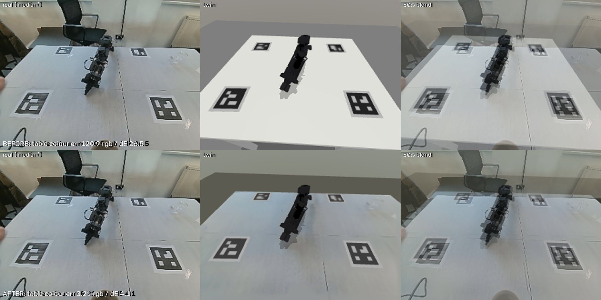

# Office twin appearance

The office twin (`SITE=office`, `sites/office/layout.json`) should look like the real office through the
overview camera, the way the home twin does: real table texture, measured table extent, fitted lighting, background
colours. Geometry (markers, cameras, arm base) comes from `sites/office/scene_calib.json` and is not touched here.



## Reproduce

Capture: `frames/calib-20261122-101741/` in the integration checkout (10 overview frames at 299x224, wrist frames,
`joints.json` with the arm pose during the overview frames). Read-only; nothing talks to Station.

```bash
export STATION_HOST=station-disabled-in-tests.invalid SITE=office MUJOCO_GL=cgl
python sim/fit_appearance.py --frames <hackathon>/ws/integration/frames/calib-20261122-101741 \
    --measure-table --near-edge 0.9 --background --rest-pose --compare sites/office/appearance_compare.jpg
python sim/build_scene.py            # renders sim/generated/site_office/*.png
```

`fit_appearance.py` median-stacks `overview_*.jpg` per pixel (a hand in some frames drops out) and reads either
`joints.json` format. For home it behaves as before: `--layout home --frames sim/layouts/home_estimate` rewrites
`sim/assets/home_table_texture.png` and the same layout fields (the new steps are opt-in flags).

## What is measured and what is estimated

| table edge (table axes, sim frame) | value | how |
| --- | --- | --- |
| yaw | 1.48 deg | slope of the far edge (136 columns, 5.7 mm rms) |
| far (behind the arm base) | y = -0.049 m | measured: rectified overview, first non-table-coloured cells |
| left (+x, image left) | x = +0.559 m | measured: 112 rows |
| right (-x, image right) | x = -0.681 m | measured, but only 7 rows at the far-right corner (the rest is out of view) |
| lengthwise seam | x = -0.074 m | measured: darkest thin line between the near markers |
| near (towards the camera) | y = +0.90 m | **estimated**: the overview sees to y = 0.63 m only |

Rectification uses the calibrated overview camera (pose, intrinsics and distortion of the layout); points beyond
the normalised radius of the frame corners are treated as unseen (the distortion polynomial folds back there).
The two far corners picked by hand back-project to (+0.584, -0.013) and (-0.676, -0.069): within 1-2 cm and 1 deg
of the automatic result. Near edge: through the twin's FK at the capture's wrist poses 2 and 5, the laptop and
keyboard seen by the wrist camera lie on the same grey table at y = 0.8-0.9 m, so the table runs at least that far;
0.9 m is a lower bound, not a measurement. Table height (0.75 m) and thickness are unchanged guesses.

## Texture, markers, lighting, background

- Texture `sites/office/table_texture.png` (620 x 474 px, 2 mm/px): every table-top point projected into the
  median overview and sampled. Holes: marker papers (the twin draws its own), the arm (twin arm silhouette at the
  capture pose, projected with the real camera, +5 px for its shadow), off-colour pixels (cable, hand) and table the
  overview does not see (42 %). Holes are filled by pyramid push-pull from the surrounding table: Telea inpainting
  dragged the arm's shadow across the whole occluded strip. The lengthwise seam is kept where seen and continued
  over the filled part; the crosswise seam at y = 0.38 m comes with the texture.
- The layout names the texture `../sites/office/table_texture.png` (relative to `sim/`) because
  `compare_real.load_model` resolves `sim/<texture>`; `build_scene` also tries the layout's own folder first.
- Marker print levels (ink, paper) = (0.243, 0.694) from the real marker pixels.
- Lighting gain 0.983 (ambient 0.737, key 0.246): table colour error 4.56 -> 0.17 rgb in the fit.
- Floor (0.365, 0.365, 0.324) and skybox (top 0.70/0.77/0.75, bottom 0.44/0.41/0.35): scaled until the rendered
  floor / sky pixels have the real mean colour there (chair, carpet, walls). A backdrop wall was considered and left
  out: the wall/floor junction back-projects to y = -2.6 m, where the twin's floor plane already ends, so the skybox
  already plays the wall.
- `rest_pose` = the captured arm pose (the previews render the rest keyframe).

## Real vs twin (compare_real, median overview, arm at the captured pose)

| metric | before | after |
| --- | --- | --- |
| overview table colour error (mean rgb / dE) | 120.9 / 26.5 | 0.21 / 4.1 |
| wrist table colour error (mean rgb / dE) | 120.5 / 26.1 | 13.7 / 6.3 |
| overview background (twin floor + sky) mean rgb error / dE | 14.0 / 16.4 | 0.5 / 15.3 |
| overview per-pixel abs error, table / all but the arm | 69.0 / 55.4 | 9.7 / 21.4 |
| overview marker corners (20, 21 detected) | 7.13 px | 7.13 px |

The marker corner error is geometry (the quick preview ignores the principal point, ~6-9 px), owned by the camera
work in `build_scene`; appearance does not change it. Home is unchanged: `SITE=home python sim/build_scene.py`
gives a byte-identical `workspace.xml` and identical preview PNGs before and after.

## Known gaps

- Near edge estimated (above). The camera stand pole (`fixed.cam_stand_pole`, from scene_calib) now stands on the
  table instead of at its edge, which agrees with the wrist views but was not checked.
- Objects lying on the real table (the plastic bag at the far right) are baked into the texture.
- The wrist view is darker in the twin (13.7 rgb): the lighting is fitted to the overview only.
