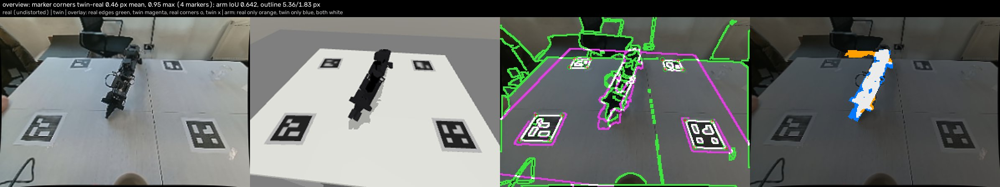
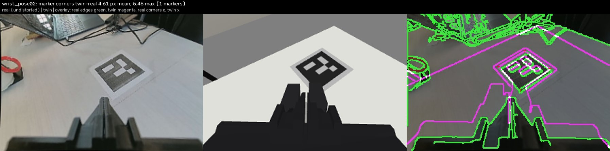
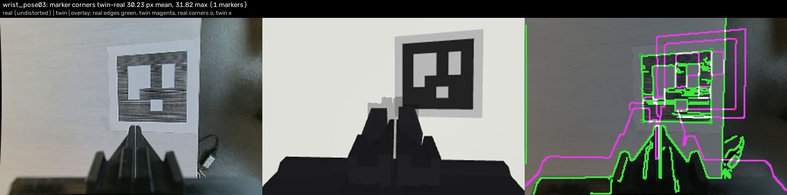

# Office table calibration

State on 22 Nov 2026, from the capture `frames/calib-20261122-101741` (taken by the integrator with
`perception.calib_scene --live --frames 90 --wrist-poses 6` while the arm was moved by hand). Full numbers:
[`sites/office/calib_report.md`](../../sites/office/calib_report.md).

## Result

| | value |
|---|---|
| overview camera | charuco intrinsics shared with home (f 143.3 px, principal point (153.5, 117.9) px at 299x224), pose from 4 markers, reproj 0.51 px |
| markers 20 / 21 / 22 / 23 | reproj 0.32 / 0.66 / 0.62 / 0.37 px; held-out rms 1.6 / 5.1 / 6.8 / 3.6 mm |
| arm base | foot (overview) + wrist markers at hand poses 2, 3, 5; sigma 8.3 mm, **4.2 deg** yaw |
| wrist mount pitch | jaw outline: +7.5 +- 1 deg over CAD (with the calibrated pinhole); not applied |
| twin overview vs real | marker corners 0.46 px mean, 0.95 px max; arm silhouette IoU 0.64 |
| twin wrist vs real | 4.6 / 30.2 / 24.7 px at poses 2 / 3 / 5 (FK chain error) |





## Verified vs not

Verified, from the saved capture:
* The twin's overview camera matches the real one to < 1 px at all four markers once (a) the twin renders with the
  calibrated principal point and fx/fy (`sim/build_scene.py` `camera_lens`, MuJoCo `focalpixel`/`principalpixel`,
  checked against a rendered point to < 0.1 px) and (b) the real frame is undistorted. Before: 8.0 px, the
  principal-point offset (-4.9, -6.6 px). Home improves the same way (8.0 -> 0.3 px).
* The marker layout: the offline and live overview fits agree to 1.2 mm after alignment.
* The wrist mount pitch from the jaw outline: +10 deg in the old pipeline (confirms home's +9.31), +7.5 deg with the
  principal point and distortion modelled.

Not verified / weak:
* **Arm base yaw** is only good to about +-4 deg. Single wrist poses disagree by +-5-7 deg (the FK chain: joint zero
  offsets, the j6 range; the mount pitch does not explain it). The new yaw is 2.2 deg from the live one; the overview
  arm silhouette sides with the new one but constrains yaw weakly. At 0.5 m reach 4 deg is ~35 mm.
* The table rectangle in `sites/office/layout.json` was derived from the old marker positions; with the new base it
  must turn with the markers (below). The table block is owned by the appearance work and was not changed here.
* Wrist poses 1, 4, 6 show markers cut by the frame edge: not usable.

## Re-run (offline, from the repository root)

```bash
export SITE=office STATION_HOST=station-disabled-in-tests.invalid
CAP=../../frames/calib-20261122-101741           # or the integration worktree's frames/ (gitignored)
python -m perception.calib_scene --frames-dir $CAP --out sites/office/scene_calib.json --force
python camera_pose/fit_wrist_chain.py --frames-dir $CAP                # mount / joint-offset models, leave-one-pose-out
python sim/sync_from_calib.py                                          # markers, cameras, T_sim_world -> sites/office/layout.json
python sim/build_scene.py                                              # twin -> sim/generated/site_office
python scripts_integrator/export_overview_cal.py                       # -> sites/office/real_overview_camera.json
python sim/compare_real.py --capture $CAP --out sim/real_compare/office   # compare_*.jpg + metrics.json
```

`sync_from_calib.py` rewrites the whole layout file (its own JSON layout) and adds `table.calib_extent_inside`;
keep the table block as the appearance work left it. `TWIN_CALIBRATED_PINHOLE=0` builds the old fovy-only twin
cameras (delete `sim/generated/site_office` so the cached model is rebuilt).

### Table pose after this calibration

The markers moved in the twin (sim) frame by a rotation of +2.206 deg about z plus (1.5, -6.8) mm (marker residuals
1.0 / 1.4 / 1.6 / 0.6 mm). Applied to the table: centre [0.035, 0.233] -> [0.0275, 0.2274], yaw 0 -> 2.206 deg.

## Recapture (needs the human at the table)

1. **Tape the arm base (no camera work, 2 minutes; pins the base to ~2 mm / ~1 deg).** Follow "Pin the arm base to
   +-2 mm with a tape measure" in `perception/README.md` with `sites/office/tape_guide.jpg`. Put the four distances in
   a copy of the config and rerun offline:
   ```bash
   cp perception/scene_config.json /tmp/office_scene_config.json   # fill arm_base.tape_mm A, B, C, D (mm)
   SITE=office python -m perception.calib_scene --frames-dir $CAP --config /tmp/office_scene_config.json \
       --out sites/office/scene_calib.json --force
   ```
2. **More wrist poses (only if the tape is not possible).** With torque off, nothing else moving:
   ```bash
   SITE=office python -m perception.calib_scene --live --frames 90 --wrist-poses 10 --out sites/office/scene_calib.json --force
   ```
   Hold each pose 2 s. Every marker must be **whole** in the wrist view (poses 1, 4, 6 of this capture had it cut by
   the frame edge), 20-35 cm away, ideally two markers at once. Cover: 22 and 23 from above beside the base (j1 turned
   left / right), 20 and 21 from the middle of the table, and the same marker with the wrist (j4/j6) tilted
   differently, so `camera_pose/fit_wrist_chain.py` can separate joint offsets from the base yaw. Afterwards run the
   chain fit and the compare above.
