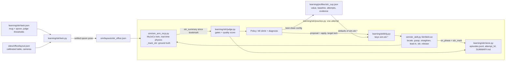

# Stirring a cup: a new skill learned in the twin

The real ElRobot arm learned to unscrew a bottle cap on 22 Nov through a loop of recorded attempts, judged outcomes
and versioned parameter changes (`docs/learning/`). This folder is the second skill taught with that loop, this time
entirely in the MuJoCo digital twin of the **office** table: **take the spoon that stands in a mug, stir the drink,
let go**. The result is a learned stir profile with provenance (`learning/profiles/stir_cup.json`) that the real arm
can try next (`REAL_RUN.md`).

Nothing here talks to NormaCore Station or the real arm: the twin is `sim/sim_arm_mcp.py`'s in-process MuJoCo arm,
which exposes the same MCP tools as the real one.

<!-- RESULTS -->

## Architecture



| piece | file | what it does |
|---|---|---|
| task | `learning/stir/task.json` | mug, spoon, start pose, judge thresholds and weights, each with the reason for its value |
| scene | `learning/stir/twin.py` -> `sim/layouts/stir_office.json` | office site layout + the task objects; the spoon is placed on the rim analytically, then MuJoCo settles it and the settled pose is written. Select with `SIM_LAYOUT=stir_office`. The site layouts are not edited. |
| skill | `sim/stir_skill.py` (`StirSkill.run`) | the r4 stir skill, now with its motion settings as arguments (defaults = the r4 code values) and a phase callback |
| twin truth | `sim/sim_arm_mcp.py` (`_track_stir`, `stir_mark`, `stir_summary(since=)`) | per physics step: bowl angle about the mug axis, bowl under the drink, spoon on wall / bottom, arm on mug, largest mug tilt; bookmarks so each phase gets its own share |
| judge | `learning/stir/judge.py` | gates and a quality score from the twin's ground truth |
| records | `learning/stir/store.py` | `episodes.jsonl` (begin / phase / judge / end), `attempt_N/` (report, bowl path, side view), `SUMMARY.md` |
| loop | `learning/stir/practice.py` | the policy, one attempt in the twin, validation, the profile writer |
| config | `skills/strategy_defaults.json`, `learning/skillcfg.py` | keys `sim.stir.radius_m, turns, height_m, step_dt_s, wall_margin_m, lean_extra_deg, grasp_from_top_m, ring_points`; every change in practice is a versioned config of target `twin` with reason and evidence |
| docs material | `learning/stir/report.py` | learning curve SVG, curated records in `docs/stir/data/` |

## The scene

The office table as calibrated (`sites/office/`: ArUco markers, overview camera with its principal point, the
measured table texture), plus a red ceramic mug 8.0 cm across (inner radius 3.6 cm, 4 mm wall) and 9.5 cm tall,
60 % full of a brown drink, 19 cm in front of the arm base; and a steel spoon 15.5 cm from bowl centre to handle end
(14 cm handle, 12 x 4 mm, 3.8 cm bowl) whose bowl lies on the bottom and whose handle rests on the rim on the side
facing the arm. That is the only side the arm can hold a tilted tool from (the wrist can lean the tool top towards the
base, not away).


Two things had to be fixed before anything could be practised (details in `JOURNAL.md`):
- the office layout's rest pose is the real arm reaching forward low over the table; its forearm lay across the mug
  and pushed the spoon off the rim. The stir layout starts from the folded pose of the r4 stir scene
  (`task.json rest_pose`);
- `refine_cup` back-projected the overview image with a centred pinhole, but the office overview camera's principal
  point is 4 px right and 6 px down of centre: the mug centre came out 4.6 cm off and every grasp missed. It now uses
  the camera matrix MuJoCo renders with.

## What the skill does

`StirSkill.run(cup_x, cup_y, ...)`, unchanged in its steps since r4:
1. **locate**: refine the given mug centre on the overview image (the red blob nearest the click).
2. **grasp**: from the mug centre, size and the handle's side, estimate the handle line; come in along it with the
   jaws closing across the handle's 12 mm width, `grasp_from_top` below its end; close; check the jaw stall; retry
   with small variations.
3. **straighten**: lift the bowl off the bottom, then swing the handle towards vertical around the bowl, as far as
   the arm reaches, moving the bowl to the mug centre at `height`.
4. **lead-in + stir**: plan one circle of `radius` (capped so the handle stays `wall_margin` inside the rim at the
   lean it has) with the spoon translating rigidly; stream it `turns` times at `step_dt` seconds per joint target.
5. **release**: open, back out along the handle, lift away. The spoon stays in the mug.

## The judge

From the twin's ground truth over the stirring window only (the spoon resting on the rim before the grasp must not
count as a scrape). Thresholds and weights are in `task.json "judge"`, each with its reason.

Gates (any failure: not stirred, score - 0.5 per failed gate):

| gate | threshold | outcome when it fails |
|---|---|---|
| spoon still in the mug at the end | - | `dropped_spoon` |
| largest mug tilt | <= 5 deg | `tipped_cup` |
| mug slid | <= 5 mm | `pushed_cup` |
| any arm link on the mug | <= 50 ms | `arm_hit_cup` |
| spoon on the mug wall or rim | <= 5 % of the stir | `scraped_wall` |
| spoon moved in the jaws | <= 1 cm | `slipped` |
| bowl centre under the drink | >= 90 % of the stir | `stirred_air` |
| net loops of the bowl about its path centre | >= 3 | `too_few_loops` |

Quality (0..1), weighted: **coverage** 0.35 (mean bowl radius about the mug axis / usable radius, inner radius minus
the bowl's half-width), **depth** 0.15 (how low in the drink the bowl circles), **pace** 0.2 (loops per second / 0.5),
**immersion** 0.1, **clean** 0.2 (1 - wall and bottom contact shares).

Loops are counted as *net* rotation of the bowl about the centre of its own path, and a path under 3 mm radius counts
none. The r4 summary summed absolute angle changes: after a failed grasp it reported 5.3 "loops" for a spoon that
only trembled.

## The practice loop

`python -m learning.stir.practice --attempts 16 --validate 5 --write-profile` (`MUJOCO_GL=cgl`, `uv run` with numpy,
scipy, pillow, mujoco, opencv-contrib-python, mcp; ~45 s per attempt in real time). Each attempt:

1. the policy picks a change from the last verdicts;
2. the change becomes a **skill-config version of target `twin`** (proposal with reason and evidence, applied at
   once, the twin rule of `learning/SELF_TUNING.md`); the run's config history is `<run>/skillcfg/changes.jsonl`;
3. `episode_begin` with the full parameter set, what changed and the hypothesis;
4. the skill runs; each phase is recorded with its measurements (grasp tries and jaw load, lean reached, the radius
   asked and the radius it fitted, the stirring window's ground truth);
5. the judge's verdict and evidence; `episode_end` with outcome and lesson.

The policy is scripted (no LLM), what a careful operator would do with the verdicts:
- **search** one key at a time in the order coverage (radius; when the fitted radius is under the asked one, the
  wall margin) -> depth (height) -> pace (step time); a clean stir that beats the best by > 0.005 makes it the best
  and repeats the move; a move that does not pay is undone and its limit recorded (it becomes evidence in the
  profile);
- **diagnose** failures that are not a search move: no grasp -> another grasp height; arm on the mug -> hold the
  handle higher; slip, pushed or tipped mug, abort -> slower; scrape -> more margin; too few loops -> one more turn;
- when every direction has its limit, **repeat** the best to check it holds.

At most 3 keys change per attempt (the bottle loop's rule). Practice starts from the code baseline
(`SKILL_PROFILES=none`), not from an earlier profile.

## Run it

```bash
export MUJOCO_GL=cgl STATION_HOST=station-disabled-in-tests.invalid
export NORMA_CORE_REPO=<path to norma-core>
UV="uv run --no-project -q --with numpy --with scipy --with pillow --with mujoco --with opencv-contrib-python --with mcp>=1.12,<2 --with httpx"
$UV python -m learning.stir.twin                     # regenerate sim/layouts/stir_office.json after editing task.json
$UV python -m learning.stir.practice --attempts 16 --validate 5 --write-profile --out data/stir/run1
$UV python -m learning.stir.report data/stir/run1   # learning curve + curated records into docs/stir/
SIM_LAYOUT=stir_office $UV python sim/sim_arm_mcp.py # the twin MCP server with the mug; stir_spoon uses the profile
```

Tests: `learning/tests/test_stir.py` (scene, judge, records, policy, one short episode in the twin).
