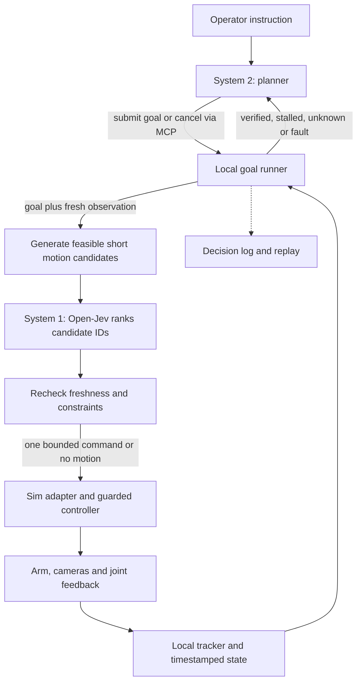

# Two-model arm: first implementation plan

**Decision:** try [Open-Jev](https://github.com/Zefan-Cai/Open-Jev) as the only learned local decision model. Use Claude or ChatGPT as the goal planner. No TabPFN, learned dynamics model, or task-specific skill registry in v1. This is a proposed simulation experiment, not a validated arm policy.

## Architecture

Two loops, different clocks: the planner runs when a goal changes or the runner reports an outcome. The runner repeats observe / rank / act as fresh evidence arrives. The motor controller keeps its own tracking and fault handling. A slow or disconnected model must not leave an open-ended movement running.

## Build in pairs

| Pair | First step | Second step | Checkpoint before proceeding |
| --- | --- | --- | --- |
| 1. Observation and goal | **1.** Wrap `elrobot-sim` camera and joint reads in an observation adapter. Track the cube and jaw midpoint with the overview image; log frame ID, age, visibility and recent displacement. Keep the wrist view for disambiguation. | **2.** Define a goal record: entity IDs, measurable relation, target band, constraints, expiry and goal ID. Start with distance between image features in a fixed view at fixed tool height; do not infer depth from pixel distance. | Replay a recorded sequence. Moving nearer/farther must change the metric in the expected direction; occlusion must produce `unknown`, never success. |
| 2. Motion and baseline | **3.** Generate a small set of short TCP displacements from the current pose, plus no motion. Give candidates unique IDs, units, reference frame and a short validity window. Start with translation at a verified clearance; add rotation and jaw changes later. | **4.** Implement the guarded runner against the twin. Use a geometric scorer first, through the same scorer interface Jev will use. Check actual motion, not just command acknowledgement. | From one scene, reach two different target-distance bands on request. Reject stale observations, unreachable commands and constraint-breaking orientation fallbacks before movement. |
| 3. Model and closed loop | **5.** Load the pinned Open-Jev 2B adapter, its required base and loader in a separate inference process. Provide state history, goal, question and candidate list; map the returned scores to candidate IDs. Benchmark warm latency and memory on the actual machine. | **6.** Run Jev in shadow (log choices without acting), then run independent Jev-controlled simulation episodes. Discard a result if its goal, scene or deadline changed during scoring. Reobserve after every action. | Compare Jev and geometry on identical held-out starting seeds and opposite goals. Record success, steps, stale decisions, false success and end-to-end p95 latency. Stop on a fault, no progress or exhausted budget. Do not promote Jev just because its scores look confident. |
| 4. Planner and transfer | **7.** Give System 2 proposed MCP tools `submit_goal`, `goal_status` and `cancel_goal`, not raw motion tools. Validate the goal schema and reject unobservable goals. Check cancellation and replanning mid-episode. | **8.** Expand the sim test to moving an object relative to another, not just moving the tool. Only after sim evaluation, add a separately selected hardware adapter. Start read-only with side-by-side observation checks. | No new task endpoint should be needed for a new entity pair or target band. Before a separately authorized physical trial, verify camera calibration, axis signs, workspace limits, operator stop and controller timing on the actual arm. |

## One decision, end to end

Instruction: "Bring the gripper near the cube without touching it." For the first experiment, "near" means a specified image-distance band in a fixed overhead view; a separate calibrated clearance constraint keeps the tool above the object.

1. The planner identifies `jaws` and `cube` and submits a distance-band goal. The runner validates that both entities and clearance are observable.
2. The runner observes, for example, that the jaws appear left of the cube. It produces short admissible motions, with their predicted image displacement from calibration, plus no motion. These are geometric options, not named behaviors.
3. Jev ranks IDs. The runner revalidates the selected motion, executes at most one bounded displacement, then measures fresh state. A predicted displacement is not evidence that the arm actually moved.
4. The runner reports success only after the observed distance stays in band across fresh frames. A lost track means `unknown`; repeated lack of progress means `stalled`. The planner may revise the goal, but cannot override controller constraints.

## Experiment discipline

- Inputs at decision time: goal, observable state history, previous command and observed result, legal candidates. Never include simulated object truth or future frames.
- Decision trace: episode/goal/frame IDs, timing, candidates, scores, chosen ID, guard result, achieved motion, next observation and terminal reason. Use simulator truth only for an independent offline score.
- Open-Jev scores are relative to the offered choices, not probabilities of physical success. Candidate generation limits what it can discover. Single-step translation can demonstrate goal conditioning, not general contact manipulation.
- The first result worth showing is a goal swap from the same pose with no code change. If geometry wins or Jev misses the freshness budget, retain geometry as the working baseline and report the result. Reconsider a supervised tabular model only when there is a concrete prediction question and enough labeled transitions to test it.
